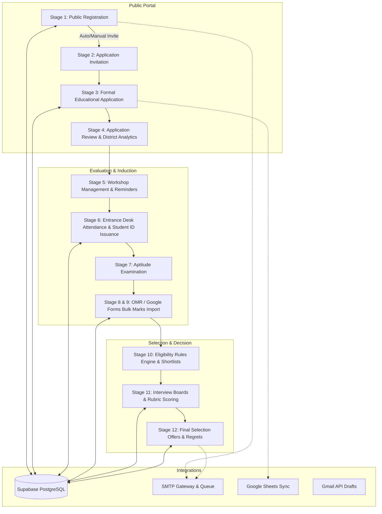

# Unicom TIC — Student Lifecycle Management Platform Architecture

## 1. Overview
The Unicom TIC Student Lifecycle Management Platform is a production-grade, secure, and auditable system engineered to manage the entire journey of students from initial public registration to final admission selection across all 25 districts of Sri Lanka.

## 2. Complete 12-Stage Lifecycle

1. **Stage 1 — Registration**:
   - Students register with verified Sri Lankan district, NIC, contact info, and accepted Terms & Conditions.
   - Generates unique reference e.g., `REG-25-XXXXX`.
2. **Stage 2 — Application Invitation**:
   - Supports configurable **Manual mode** (admin filters and sends invites) and **Automatic mode** (immediate email dispatch on registration).
3. **Stage 3 — Formal Application**:
   - Secondary education (G.C.E. O/L), higher secondary (G.C.E. A/L Stream & Z-Score), emergency contact, and statement of purpose.
   - Generates unique application number `APP-25-XXXX`.
4. **Stage 4 & 5 — Application Analytics & Workshops**:
   - District-wise analytics covering all 25 Sri Lankan districts.
   - Multi-workshop scheduling with Google Maps links and automated 3-day / 1-day reminder scheduling.
5. **Stage 6 — Entrance Attendance Desk & Student IDs**:
   - Fast entrance desk search by NIC last 4 digits, phone, or name.
   - Reuses or generates unique sequential Student/Exam IDs e.g., `TIC-2025-XXXX`.
6. **Stage 7 — Examination Management**:
   - Configurable exam papers, max marks, pass mark thresholds, and attendance prerequisites.
7. **Stage 8 & 9 — OMR Marks & Google Forms Import**:
   - Ingests CSV/Excel scanner files, detects anomalies (negative/out-of-range marks, duplicates, unverified students), previews rows, and commits safely with audit logging.
8. **Stage 10 — Eligibility Filtering**:
   - Configurable rules: minimum exam score, attendance required, application completed, cohort capacity limit, and tie-breaking.
9. **Stage 11 — Interview Management**:
   - Panel allocation, candidate time slots, and confidential evaluation rubrics (Communication, Technical, Analytical, Overall, Recommendation).
10. **Stage 12 — Final Selection**:
    - Final statuses: Selected, Waiting List, Unsuccessful.
    - Bulk decision notification dispatch via custom email templates.
