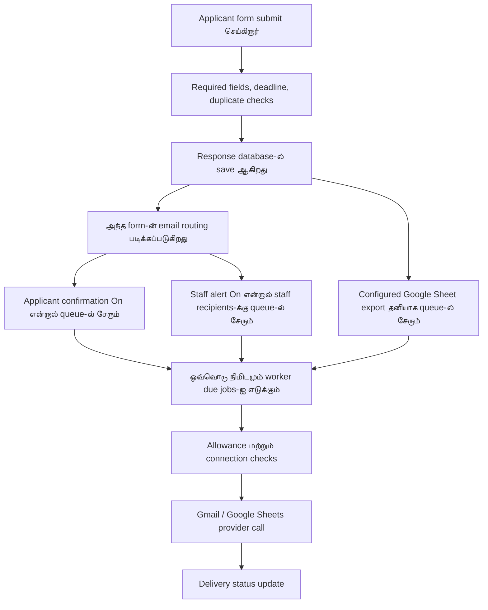

# UTICX — தற்போதைய Email Sending Process & Template Setup

**Live settings சரிபார்த்த தேதி:** 28 அக்டோபர் 2026 · Sri Lanka நேரம்  
**Portal:** https://uticx.com  
**இந்த document:** இப்போது email எப்படி அனுப்பப்படுகிறது, எந்த form எந்த template பயன்படுத்துகிறது, அதை எங்கே மாற்ற வேண்டும் என்பதற்கான administrator guide. இந்த guide உருவாக்கும்போது settings மாற்றவோ test email அனுப்பவோ இல்லை.

**புதிய implementation:** Multiple SMTP accounts, form-wise applicant/staff sender தேர்வு, manual bulk email மற்றும் delivery filters இப்போது code-ல் சேர்க்கப்பட்டுள்ளன. கீழே உள்ள live settings audit-ஐ இந்த வேலை மாற்றவில்லை. Release/setup விவரங்கள்: [SMTP Email Management](SMTP_EMAIL_MANAGEMENT.md).

### புதிய SMTP / Manual Email வசதிகளைப் பயன்படுத்துவது

1. **Email Center → SMTP Configuration → Add SMTP account**: host, port, STARTTLS/TLS, username, app password, From மற்றும் தேவையான Reply-To நிரப்பவும். Save செய்வதால் default sender தானாக மாறாது.
2. **Verify connection** mail அனுப்பாமல் connection/authentication-ஐ சோதிக்கும். Mail delivery test-க்கு உங்கள் test inbox-ஐ வெளிப்படையாக உள்ளிட்டு **Queue test email** பயன்படுத்தவும்; allowance பொருந்தும்.
3. **Set default** மூலம் பொதுவான sender தேர்வு. **Form Email Routing**-ல் applicant/staff account-களை தனியாக மாற்றலாம். Fallback தேவையென்றால் மட்டும் தேர்வு செய்யவும்; uncertain sends அல்லது daily allowance wait-க்கு fallback இல்லை.
4. **Manual Email Center**-ல் candidates-ஐ intake/form/status/workshop மூலம் filter செய்து தேர்வு செய்யலாம்; direct email addresses-மும் சேர்க்கலாம். **Saved template**, subject/message, account தேர்வு செய்தபின் **Preview & review recipients** அழுத்தவும்.
5. Duplicate addresses நீக்கப்பட்ட count காட்டப்படும். பல recipients இருந்தால் confirmation checkbox அவசியம். ஒவ்வொருவருக்கும் தனித்தனி email; மற்றவர்களின் addresses தெரியாது.
6. **Delivery Activity → More delivery filters**-ல் date/form/intake/purpose/account/manual-automatic filter செய்யலாம். Provider ID அல்லது batch reference மூலமும் தேடலாம்.
7. **Uncertain** என்றால் provider records சரிபார்க்கவும். ஏற்கெனவே accepted என்றால் **Record verified acceptance**-ல் provider ID கொடுத்து resend இல்லாமல் பதிவு செய்யலாம். அனுப்பப்படவில்லை என்று சரிபார்த்த பிறகே Retry பயன்படுத்தவும்.

Saved passwords response-ல் வராது; edit-ல் password காலியாக விட்டால் பழைய credential தொடரும். புதிய environment secrets அல்லது SQL migration தேவையில்லை; தற்போதைய encryption key-ஐ மாற்ற வேண்டாம்.

## 1. இப்போது உள்ள setup

| விஷயம் | தற்போதைய நிலை |
| --- | --- |
| Email அனுப்பும் provider | Gmail API |
| Sender account | `unicomtic2026@gmail.com` |
| Admissions staff notification account | `unicomtic2026@gmail.com` |
| SMTP | தற்போதைய sending provider இல்லை; இப்போது Gmail தான் பயன்படுத்தப்படுகிறது |
| Automatic worker | Supabase Cron மூலம் ஒவ்வொரு நிமிடமும் இயக்கப்படுகிறது |
| Portal daily sending allowance | கடந்த 24 மணி நேரத்தில் அதிகபட்சம் 500 dispatch reservations; provider limit தனியாகவும் பொருந்தும் |
| Registration form | Published; applicant confirmation மற்றும் staff alert இரண்டும் On |
| Application form | Published; **Open application**; applicant confirmation மற்றும் staff alert இரண்டும் On |
| Additional staff recipients | இரண்டு forms-க்கும் தற்போது இல்லை |
| Registration receipt-ல் application link | தற்போது **None** |

500 என்பது portal வைத்துள்ள sending allowance. Google அதை முழுவதும் அனுமதிக்கும் என்ற உத்தரவாதம் அல்ல. Google sending limit அல்லது account பிரச்சனை இருந்தால் delivery தாமதமாகலாம்.

## 2. Form submit ஆனதும் என்ன நடக்கிறது?



1. Form active ஆக உள்ளதா, opening/closing date சரியா, தேவையான answers உள்ளனவா என்று server பார்க்கும்.
2. Email, NIC, phone identity மற்றும் ஏற்கனவே submit செய்த record உள்ளதா என்று duplicate checks நடக்கும்.
3. Response save செய்யப்பட்ட பிறகு reference number கிடைக்கும்.
4. அந்த **form-க்கு set செய்த template** மூலம் confirmation மற்றும் staff alert உருவாக்கப்படும்.
5. Emails உடனே submit request-க்குள் அனுப்பப்படாமல், persistent queue-ல் சேமிக்கப்படும்.
6. Worker ஒவ்வொரு நிமிடமும் due jobs-ஐ process செய்யும். Backlog, allowance, provider retry ஆகியவற்றைப் பொறுத்து actual sending நேரம் மாறும்.
7. Gmail ஏற்றுக்கொண்டால் job **Sent** ஆகும்; provider message ID சேமிக்கப்படும்.

**Form saved** என்பதும் **Email sent** என்பதும் தனித்தனி நிலைகள். Email connection தற்காலிகமாக வேலை செய்யாவிட்டாலும், வெற்றியாகச் சேமிக்கப்பட்ட application அழியாது. ஒரு minute schedule இருப்பதால் ஒவ்வொரு email-மும் கட்டாயம் 60 seconds-க்குள் செல்லும் என்று கருத வேண்டாம்.

## 3. எந்த form-க்கு எந்த template set ஆகியுள்ளது?

### Registration

| Setting | தற்போதைய value |
| --- | --- |
| Form | **Unicom TIC - Register your interest for 2027** |
| Public URL | https://uticx.com/form/tic-2027-registration |
| Applicant confirmation | **This form's custom confirmation** |
| Staff alert | **This form's custom staff template** |
| Staff destination | `unicomtic2026@gmail.com` |
| Optional application link | **None · registration receipt only** |

**Applicant subject:**

```text
Registration Received - Unicom TIC Intake [{{reference_no}}]
```

**Staff subject:**

```text
New Student Intake Registration: {{fullName}} ({{district}})
```

Registration submit செய்தவருக்கு registration confirmation வரும். Admissions account-க்கு staff alert வரும். தற்போது அந்த receipt-ல் application link தானாகச் சேர்க்கப்படாது.

### Application

| Setting | தற்போதைய value |
| --- | --- |
| Form | **2027 Unicom TIC Scholarship Program Application** |
| Public URL | https://uticx.com/form/tic-2027-formal-application |
| Application access | **Open application** |
| Applicant confirmation | **This form's custom confirmation** |
| Staff alert | **This form's custom staff template** |
| Staff destination | `unicomtic2026@gmail.com` |

**இப்போது சேமிக்கப்பட்டுள்ள applicant subject:**

```text
2025 Unicom TIC Scholarship Application Submitted - [{{reference_no}}]
```

**Staff subject:**

```text
New Scholarship Application: {{fullName}}
```

**தற்போதைய wording வேறுபாடு:** form title 2027; applicant email subject-ல் இன்னும் **2025** உள்ளது. முன்பே வைத்த custom wording பாதுகாக்கப்பட்டுள்ளதால் இந்த பழைய year இருக்கிறது. Subject-ஐ மாற்ற வேண்டிய இடம் section 5-ல் உள்ளது. இந்த document எழுதும்போது subject மாற்றப்படவில்லை.

Year இல்லாமல் பயன்படுத்தக்கூடிய ஒரு subject உதாரணம்:

```text
Unicom TIC Application Received [{{reference_no}}]
```

இது பரிந்துரைக்கப்பட்ட wording மட்டும்; live-ல் தற்போது set செய்த value அல்ல.

### Staff message body பற்றி

இரண்டு forms-க்கும் தனி custom staff body தற்போது சேமிக்கப்படவில்லை. அதனால் பொதுவான **New submission — staff notification** body பயன்படுத்தப்படுகிறது; மேலே உள்ள form-specific staff subject பயன்படுத்தப்படுகிறது. தனி staff message வேண்டுமென்றால் **Edit templates**-ல் அந்த form-ன் **staff alert** entry-ஐ edit செய்து save செய்யலாம்.

## 4. Template தேர்வு செய்யும் இடம் — Form routing

**திறக்க:** [Email Templates](https://uticx.com/admin/email/templates) → **Form routing**

ஒவ்வொரு form card-லும்:

| Control | என்ன செய்கிறது? |
| --- | --- |
| Applicant confirmation | Applicant-க்கு எந்த confirmation template அனுப்புவது என்பதைத் தேர்வு செய்யும் |
| Admissions staff alert | Staff-க்கு எந்த alert template அனுப்புவது என்பதைத் தேர்வு செய்யும் |
| Additional staff recipients | கூடுதல் staff email addresses; comma வைத்து பிரிக்கலாம் |
| Optional application link | Registration receipt-ல் எந்த application form link சேர்க்க வேண்டும் என்பதைத் தேர்வு செய்யும் |
| Save routing | அந்த form-ன் live sending rules-ஐ save செய்யும் |

**Applicant confirmation choices:**

- **Off · no applicant confirmation** — அந்த form submission-க்கான applicant confirmation செல்லாது.
- **This form's custom confirmation** — அந்த form-ன் தனி subject/message பயன்படுத்தப்படும்.
- **Registration confirmation template** — shared registration template பயன்படுத்தப்படும்.
- **Application confirmation template** — shared application template பயன்படுத்தப்படும்.
- **General form confirmation template** — shared general receipt பயன்படுத்தப்படும்.

**Staff alert choices:**

- **Off · no staff alert**.
- **This form's custom staff template**.
- **New submission staff template** — shared staff notification.

Staff alert On என்றால் configured admissions notification address-மும் சேர்க்கப்படும். தற்போது அது `unicomtic2026@gmail.com`. Additional addresses-ல் அதே address மீண்டும் இருந்தால் uppercase/lowercase மற்றும் spaces normalize செய்யப்பட்டு duplicate recipient நீக்கப்படும்.

**Off-ன் வரம்பு:** இந்த dropdowns submission confirmation / staff alert-ஐ மட்டுமே கட்டுப்படுத்துகின்றன. Workshop booking, workshop reminder, interview/result notification, manually requested secure link போன்ற வேறு events-ஐ முழுவதுமாக நிறுத்துவதில்லை.

## 5. Subject / message wording மாற்றும் இடம் — Edit templates

**திறக்க:** [Email Templates](https://uticx.com/admin/email/templates) → **Edit templates**

### இப்போது உள்ள application subject-ல் 2025 மாற்றுவது

1. **Form templates** group-ல் **2027 Unicom TIC Scholarship Program Application — confirmation** தேர்வு செய்யுங்கள்.
2. **Email subject** மாற்றுங்கள்.
3. தேவையானால் **Email message** மாற்றுங்கள்.
4. Sample preview பார்த்து **Save template** அழுத்துங்கள்.

தற்போது routing-ல் அந்த form-ன் custom confirmation தேர்வு செய்யப்பட்டுள்ளதால், இந்த entry-ஐ மாற்றினால் அடுத்த புதிய application confirmations-க்கு அது பொருந்தும்.

### Shared template பயன்படுத்த வேண்டுமென்றால்

1. **Edit templates**-ல் **Application confirmation** shared template-ஐ edit செய்து save செய்யுங்கள்.
2. **Form routing**-க்கு செல்லுங்கள்.
3. Application form card-ல் **Applicant confirmation → Application confirmation template** தேர்வு செய்யுங்கள்.
4. **Save routing** அழுத்துங்கள்.

**முக்கியமான வேறுபாடு:** shared Application confirmation template-ஐ edit செய்தாலும், routing இன்னும் **This form's custom confirmation** என்று இருந்தால், அந்த form தொடர்ந்து தனது custom wording-ஐத்தான் பயன்படுத்தும்.

தமிழ் / English இரண்டிலும் எழுதலாம். Central editor-ல் save செய்யும் text email HTML-க்காக escape செய்யப்படும். பழைய HTML template-ஐ central editor-ல் மீண்டும் save செய்தால் அதன் formatting edited plain-text layout-க்கு மாறும்.

## 6. Variables எப்படி வேலை செய்கின்றன?

Subject அல்லது message-ல் UI காட்டும் available variable tokens-ஐ copy செய்யுங்கள்.

| Token | பயன்பாடு |
| --- | --- |
| `{{fullName}}` | Form applicant-ன் முழுப் பெயர் |
| `{{name}}` | Shared templates-ல் candidate பெயர் |
| `{{reference_no}}` | Form submission reference; registration-க்கு REG…, application-க்கு APP… |
| `{{reference}}` | அந்த notification-க்கான reference |
| `{{formTitle}}` | Form title |
| `{{district}}` | Applicant district |
| `{{submissionType}}` | Registration / application வகை |
| `{{applicationCount}}` | Application count — supported staff/form templates-ல் |
| `{{registrationCount}}` | Registration record count — supported staff/form templates-ல் |

**எல்லா tokens-மும் எல்லா templates-க்கும் கிடையாது.** தேர்வு செய்த template-ன் **Available variables** பட்டியலில் உள்ள tokens மட்டும் பயன்படுத்துங்கள். Custom question variables அந்த form-ன் field IDs-ஐப் பொறுத்து இருக்கும். தெரியாத variable இருந்தால் central editor save செய்யும்போது error காட்டும்.

உதாரணம்:

```text
Subject: Application received [{{reference_no}}]

Dear {{fullName}},

Your application for {{formTitle}} has been received.
Reference: {{reference_no}}

Unicom TIC Admissions
```

Form's custom template-க்கு தேவையான variables நிரப்ப முடியாத நிலையில், submission notification code shared confirmation/staff content-க்கு fallback செய்யலாம். ஆகவே variable names சரியா என்பதைப் பார்த்து, optional answer காலியாக இருந்தாலும் message பொருள் தரும்படி எழுதுங்கள். Preview sample values மட்டும் காட்டும்; actual delivery proof அல்ல.

## 7. Open application மற்றும் secure link — இரண்டு வேறு தேவைகள்

### தற்போதைய Open application

- Applicant நேரடியாக application URL திறந்து submit செய்யலாம்.
- முன் registration form submit செய்திருக்க வேண்டியதில்லை.
- Application submit செய்வதற்கு secure email link காத்திருக்க வேண்டியதில்லை.
- Application மற்றும் அதன் internal tracking record ஒன்றாக save செய்யப்படும். தனியாக registration confirmation தானாக அனுப்பப்படாது.
- Application closing date, required fields, response limit, duplicate checks தொடரும்.
- Private tracking page-க்கு secure email verification தொடரும்.

**Mode மாற்றும் இடம்:** Form Builder → **Settings → General → Who can apply? → Application access**. Publish / Update form செய்த பிறகு mode மாறும்.

புதிய admissions-க்கு மேலே குறிப்பிடப்பட்ட `/form/...` public URL-களை share செய்யுங்கள். பழைய `/register` screen legacy flow-ஐப் பயன்படுத்துகிறது. பழைய `/apply` link-க்கு அதே intake-ல் ஒரு Open application இருந்தால் அந்த public form-க்கு நேராக redirect ஆகும்; இல்லாவிட்டால் பழைய restricted application flow தொடரும். தற்போதைய Open application-க்கான நேரடி URL `/form/tic-2027-formal-application`.

**Registered applicants only** தேர்வு செய்தால் invitation மற்றும் secure candidate session requirement மீண்டும் பொருந்தும். புதிய application forms Open mode-ல் உருவாகும்; பழைய form-ல் explicit mode இல்லாவிட்டால் restricted behavior தொடரும்.

### Secure access email எப்போது வரும்?

ஒருவர் private tracking அல்லது restricted application access-க்காக secure link கேட்கும்போது வருகிறது. இது application accepted confirmation அல்ல.

| விஷயம் | அமைப்பு |
| --- | --- |
| Template | **Secure candidate access link** |
| Link validity | Dispatch செய்யப்பட்ட நேரத்திலிருந்து 30 நிமிடங்கள் |
| Verified access session | ஒரு மணி நேரம் |
| மீண்டும் அதே link request | Pending request deduplication; sent request-க்கு 5-minute resend cooldown |

புதிய secure-link requests-க்கு registration ஒன்றுக்கு ஒரு மணி நேரத்தில் அதிகபட்சம் மூன்று requests என்ற rate limit-மும் உள்ளது. Deduplicate செய்யப்பட்ட repeated clicks புதிய email ஆக queue செய்யப்படாது.

Secure link அனுப்பப்படும் நேரத்தில்தான் உருவாகிறது. Queue-ல் காத்திருக்கும் நேரம் அதன் 30-minute validity-ஐக் குறைக்காது. இந்த template-ல் private link மற்றும் expiry notice system மூலம் சேர்க்கப்படும்.

## 8. Registration email-ல் application link சேர்ப்பது

**Form routing → Registration card → Optional application link**

1. **None** வைத்தால் registration receipt மட்டும்; application link சேர்க்கப்படாது.
2. ஒரு application தேர்வு செய்தால், registration **invited** status-ல் இருந்து, target அதே intake-க்கு சேர்ந்ததும் தற்போது responses ஏற்கக்கூடியதுமான form ஆக இருந்தால் link சேர்க்கப்படும்.
3. Open application என்றால் direct public URL பயன்படுத்தப்படும்.
4. Restricted application என்றால் அந்த form-க்கு செல்லும் secure email link உருவாக்கப்படும்.
5. இது ஏற்கனவே செல்லும் registration receipt-ல் சேரும் link; கூடுதல் invitation email அல்ல.

தற்போதைய இரண்டு forms-க்கும் optional application target காலியாகவே உள்ளது.

## 9. வேறு காரணங்களுக்காக வரும் emails

| Email வகை | எப்போது உருவாகும்? | Template மாற்றும் இடம் |
| --- | --- | --- |
| Workshop booking confirmation | புதிய workshop seat booking உறுதியாகும்போது | Edit templates → Workshop booking confirmation |
| Workshop reminder | Booked workshop-ன் configured reminder schedule படி worker queue செய்யும்போது | Edit templates → Scheduled workshop reminder |
| Application invitation | Staff registration workflow-ல் invitation action செய்யும்போது | Edit templates → Application invitation |
| Interview invitation | Staff candidate-ஐ interview-க்கு assign செய்யும்போது | Edit templates → Interview invitation |
| Final result | Staff result notification queue செய்யும்போது | Edit templates → Selected / Waiting list / Unsuccessful |
| Application / workshop follow-up | Staff Student Reminders-ல் recipients மற்றும் message review செய்து அனுப்பும்போது | Edit templates → Student reminders group |
| Personal candidate message | Staff Email Center composer-ல் அனுப்பும்போது | Edit templates → Personal candidate message starting text |
| Test notification | Staff குறிப்பாக Send test notification பயன்படுத்தும்போது | Edit templates → Sender test notification |

ஒரே applicant form submit செய்து workshop-மும் book செய்தால், form confirmation-க்கும் workshop booking confirmation-க்கும் தனித்தனி emails வரலாம். அது ஒரே confirmation duplicate ஆனது என்று தானாகக் கருதக் கூடாது. Staff alert-ம் வேறு audience-க்கான message.

தற்போதைய இரண்டு form configurations-லும் workshop selection enable செய்யப்படவில்லை.

## 10. ஏன் ஒரே நபருக்கு இரண்டு emails வரலாம்?

| நிலை | விளக்கம் |
| --- | --- |
| Applicant receipt + staff alert | Staff notification address-ஐ applicant email-ஆகப் பயன்படுத்தி test செய்தால் இரண்டு roles-க்கும் messages வரலாம் |
| Confirmation + secure access | ஒன்று submission receipt; மற்றொன்று கேட்ட private access link |
| Confirmation + workshop booking | Submission மற்றும் workshop booking இரண்டு events |
| Confirmation + staff-triggered invitation/reminder | பின்னர் staff அல்லது configured reminder மூலம் உருவான தனி event |
| அதே submission மீண்டும் retry | Retry keys, queue keys, intake identity checks மூலம் repeated confirmation தவிர்க்கப்படுகிறது |

Duplicate audit செய்யும்போது subject மட்டும் பார்க்காமல் **candidate/reference, email purpose, queue job, provider message ID, timestamp** ஆகியவற்றை ஒப்பிட வேண்டும்.

## 11. Email அனுப்பிய நிலையை எங்கே பார்க்கலாம்?

**திறக்க:** [Email Center](https://uticx.com/admin/email) → **Delivery activity**

| Status | அர்த்தம் / அடுத்த செயல் |
| --- | --- |
| Queued | Save ஆகியுள்ளது; worker dispatch செய்யக் காத்திருக்கிறது |
| Sending | Worker தற்போது provider-க்கு அனுப்புகிறது |
| Sent / Accepted by provider | Gmail / SMTP ஏற்றுக்கொண்டது; inbox delivery அல்லது read confirmation அல்ல |
| Waiting for daily limit | Allowance அல்லது provider cooldown முடியும் வரை காத்திருக்கும் |
| Failed / retry scheduled | Error மற்றும் next retry நேரம் பார்க்கவும்; எல்லா failed jobs-க்கும் automatic retry இருக்காது |
| Blocked | Connection/configuration repair தேவை; சரிசெய்த பிறகு retry செய்யலாம் |
| Not confirmed / Uncertain | Provider ஏற்றுக்கொண்டிருக்கலாம்; Gmail Sent / SMTP logs பார்த்த பிறகே retry செய்ய வேண்டும் |

Source form தெரிந்த jobs-க்கு form பெயர் காட்டப்படும். Submission confirmations, staff alerts, requested secure links தனி labels-ல் தெரியும். சில பழைய/manual/system jobs-ல் form source metadata இல்லாமல் இருக்கலாம்.

Gmail connection-க்கு தற்போது `gmail.send` permission மட்டுமே உள்ளது; portal Gmail Sent message bodies-ஐப் படிப்பதில்லை. Portal audit stored outgoing content, job history மற்றும் provider confirmation IDs-ஐப் பயன்படுத்துகிறது.

## 12. Allowance, retries மற்றும் duplicate protection

- Current portal allowance: rolling 24 hours-ல் 500. Applicant receipt, ஒவ்வொரு staff recipient email, secure access, workshop மற்றும் மற்ற notifications அனைத்தும் allowance-ல் பங்கு பெறும்.
- உதாரணம்: 300 submissions × applicant receipt + ஒரு staff alert = 600 emails. Portal limit 500 என்றால் மீதமுள்ளவை allowance கிடைக்கும் வரை queue-ல் இருக்கும். இது actual dispatch reservations / provider outcome-ஐப் பொறுத்தது.
- Provider-ன் daily sending limit வந்தால் email sending தற்காலிகமாக pause ஆகலாம்; records queue-ல் பாதுகாக்கப்படும்.
- Temporary provider errors-க்கு delayed retries இருக்கும்; permanent/configuration failures-க்கு staff repair தேவைப்படலாம்.
- Uncertain email தானாக மறுபடியும் அனுப்பப்படாது. இதனால் provider ஏற்றுக்கொண்ட email மீண்டும் அனுப்பப்படும் அபாயம் குறைகிறது.
- ஒரே email/NIC/phone-ஐ வைத்து intake-க்குள் duplicate admissions records உருவாக்குவதை identity checks கட்டுப்படுத்துகின்றன.
- ஒரே submission retry-க்கு ஒரே saved result பயன்படுத்தப்படும்; applicant confirmation மீண்டும் queue செய்யப்படாது.
- Additional staff recipients normalize செய்யப்பட்டு deduplicate செய்யப்படுகின்றனர்.

Google Sheet export-ம் தனி queue job. Applicant confirmation Off செய்ததற்காக Sheet export Off ஆகாது; Sheet sync form integration settings-ஐப் பொறுத்தது.

## 13. Save செய்த பிறகு எது மாறும்?

| நீங்கள் செய்வது | விளைவு |
| --- | --- |
| Save template | தேர்வு செய்த template wording save ஆகும்; email தானாக அனுப்பப்படாது |
| Save routing | அந்த form-ன் அடுத்த submissions-க்கு template selection / sending rules மாறும் |
| Applicant Off | அந்த form-ன் அடுத்த submission applicant confirmation நிற்கும் |
| Staff Off | அந்த form-ன் அடுத்த submission staff alert நிற்கும் |
| Existing queued email | Queue செய்தபோதைய content / selection தொடர்ந்து இருக்கும் |
| Already sent email | Mailbox-ல் சென்ற content மாறாது; edit செய்ததற்காக மீண்டும் அனுப்பப்படாது |

Builder-ல் saved draft இருந்தால் central routing save conflict காட்டும். முதலில் draft-ஐ **publish அல்லது discard** செய்து, routing reload செய்து save செய்யுங்கள். வேறு administrator save செய்திருந்தாலும் stale version overwrite செய்யப்படாது.

## 14. விரைவாகப் பயன்படுத்த வேண்டிய நடைமுறை

1. Form பெயர், year, public URL, Open / restricted mode, closing date சரிபார்க்கவும்.
2. **Form routing**-ல் அந்த form-க்கு சரியான confirmation / staff template தேர்வு செய்து save செய்யவும்.
3. **Edit templates**-ல் routing-ல் தேர்ந்தெடுத்த entry-ஐ மட்டும் edit செய்யவும்; subject year மற்றும் variables சரிபார்க்கவும்.
4. Staff recipients தேவையானவர்களா என்று பார்க்கவும்.
5. Registration receipt-ல் application link வேண்டுமென்றால் சரியான target form தேர்வு செய்யவும்; வேண்டாம் என்றால் None வைத்திருக்கவும்.
6. Real submissions வந்ததும் **Delivery activity**-ல் form, purpose மற்றும் status பார்க்கவும்.
7. Uncertain sends-ஐ provider-ல் சரிபார்க்காமல் retry செய்ய வேண்டாம்.

## 15. Technical reference

இது developer/support reference மட்டும்; தினசரி template setup-க்கு மேலே உள்ள admin screens போதும்.

| பகுதி | Project source |
| --- | --- |
| Submission save + email preparation | `src/lib/admissions/service.ts` |
| Default template catalog / variables | `src/lib/email/template-catalog.ts` |
| Saved shared templates | `src/lib/email/notification-templates.ts` |
| Form routing API | `src/app/api/admin/email/routing/route.ts` |
| Central template editor API | `src/app/api/admin/email/templates/route.ts` |
| Scheduled queue worker | `src/lib/jobs/scheduled-queue.ts` |
| Email / Sheets queue processing | `src/lib/jobs/outbox.ts` |
| Gmail / SMTP provider call | `src/lib/email/smtp-client.ts` |
| Daily sending allowance | `src/lib/email/sending-budget.ts` |
| Secure link generation / session | `src/lib/security/candidate-access.ts` |

Form-specific wording மற்றும் routing settings existing admissions snapshot-ல் form configuration-ஆக சேமிக்கப்படுகின்றன. Shared wording `emailTemplates`-ல் இருக்கும். Worker origin / credential private Vault-ல் இருக்கும். இந்த guide-ல் password, OAuth token, client secret, worker secret அல்லது applicant answers சேர்க்கப்படவில்லை.
