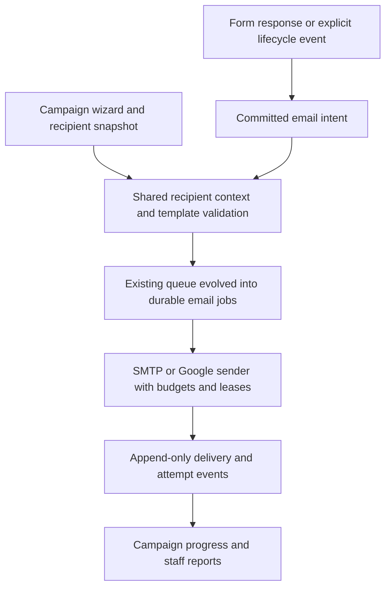

# Form-based Email Management — Analysis & Implementation Plan

Date: 30 October 2026 · Status: **Implementation started locally; production release pending**

## Implementation progress — 30 October 2026

- Form Campaigns screen/API added: choose form, filter responses, select all or specific responses, choose existing form/system template and SMTP account, preview actual recipient content, queue now or schedule. Per-response jobs use the existing outbox and show batch/recipient progress. Current batch limit: 500.
- Reusable HTML templates can now be created, edited, duplicated, archived/restored and scoped to one form or all forms. Content is sanitized, template changes keep revisions, and campaigns record the chosen version. The first editor uses HTML source with a sample preview; a non-technical rich-text editor and direct test-send remain for a later phase.
- Missing placeholder values now block form-specific submission emails with a visible `TEMPLATE_INVALID` job and audit entry; accepted form responses still save. Generic retry/release cannot send that invalid snapshot. Known legacy `preferredProgram` uses the explicit “To be confirmed” fallback.
- Daily admin report added for Asia/Colombo dates: responses, queued/scheduled/sent/failed, current backlog and groupings. Delivered/bounced remain unavailable without provider confirmation.
- Main test runner now excludes local release checkouts under `.data/`. Validation: 630 full-suite tests passed; an additional scheduled/empty-selection test passed afterward. TypeScript, `git diff --check` and the Next.js production build passed with all new pages and APIs.
- Remaining phases: non-technical rich-text editing and direct test-send, automation configuration, normalized database/queue migration for scale, provider delivery events, scoped staff reports and scheduled report emails. The current campaign and report features still use the canonical aggregate store; large-batch production rollout requires the Phase 2 storage/concurrency gates below.

## 1. முடிவு: Existing system-ஐ மேம்படுத்தலாம்

முழு application-ஐ rebuild செய்யத் தேவையில்லை. Multiple SMTP accounts, encrypted credentials, durable queue, retries, duplicate protection, form confirmations, workshop reminders ஏற்கனவே உள்ளன. முக்கிய மாற்றம்: இவற்றை ஒரே form-based workflow-ல் இணைப்பது; template rendering மற்றும் tracking-ஐ ஒரே source-ல் நடத்துவது; பெரிய campaigns-க்கு storage/queue contention-ஐ குறைப்பது.

இந்த report-க்காக source, migration files மற்றும் production aggregate/table counts read-only முறையில் ஆய்வு செய்யப்பட்டன. Code, production configuration அல்லது database மாற்றப்படவில்லை. கீழே உள்ள schema மற்றும் புதிய file names **proposals**, implemented features அல்ல.

## 2. Staff பயன்படுத்தும் எளிய flow

1. **Email Management → Form Campaigns** சென்று ஒரு form தேர்வு செய்யவும்.
2. Total responses, valid recipients, already contacted, failed ஆகிய counts பார்க்கவும்.
3. All matching responses / selected people / new / not contacted / custom answers மூலம் recipients தேர்வு செய்யவும்.
4. Saved template தேர்வு செய்து, actual recipient data உடன் preview பார்க்கவும்.
5. SMTP account தேர்வு செய்யவும்; default account தானாக இருக்கும்.
6. Missing information இருந்தால் affected people + காரணம் காட்ட வேண்டும். Fix செய்யலாம் அல்லது explicitly exclude செய்யலாம்.
7. Test email அனுப்பி, final recipient count உறுதி செய்து **Send now / Schedule** செய்யவும்.
8. Campaign screen-ல் individual progress மற்றும் failures பார்க்கவும்.

Form responses-ஐ CSV export/import செய்யத் தேவையில்லை. New responses campaign picker-ல் தானாக கிடைக்கும். Already scheduled campaign-க்கு புதியவர்கள் silently சேரக்கூடாது; automatic communication வேண்டுமெனில் Automation பயன்படுத்த வேண்டும்.

## 3. Existing architecture

| Area | Actual implementation | Implication |
|---|---|---|
| Frontend/backend | Next.js 16.4.3, React 19.3.1, TypeScript; server route handlers | Existing conventions-ஐ தொடரலாம்; code எழுதும்போது bundled Next documentation படிக்க வேண்டும் |
| Database client | Supabase JS; server-side repository | Browser-க்கு service-role credential அனுப்பக்கூடாது |
| Canonical data | `public.platform_state`, `admissions` row, JSONB `data` + version | Normalized tables மட்டும் பார்த்தால் live records தெரியாது |
| Transactions | `repository.ts`, `save_platform_state` compare-and-swap, retries | Response + email intent தற்போது ஒரே aggregate transaction-ல் save ஆகின்றன |
| Sending | Nodemailer SMTP / Google connection, existing outbox worker | புதிய independent sender தேவையில்லை |
| Scheduling | Next `/api/cron/process-queue`; SQL scheduler uses pg_cron + pg_net | Vercel Hobby daily cron மட்டும் நம்ப வேண்டியதில்லை |
| UI | Templates, form routing, candidate composer, notifications, SMTP screens | பல இடங்களில் settings பிரிந்திருப்பதே முக்கிய UX பிரச்சினை |

`store.ts`-ல் உள்ள `campaigns` என்பது admissions intake; proposed **email campaigns** அதிலிருந்து வேறு business entity.

### Production read-only snapshot

இந்த ஆய்வின்போது கிடைத்த point-in-time counts; scheduler காரணமாக தொடர்ந்து மாறலாம்:

| Canonical aggregate | Count |
|---|---:|
| Students / registrations / applications | 2 / 2 / 1 |
| Custom forms / form responses | 3 / 3 |
| Workshops / bookings | 1 / 0 |
| SMTP accounts | 1 |
| Outbox records | 18: 12 sent emails + 6 sheet jobs |
| Legacy `emailJobs` array | 0 |
| System-template overrides | 0 |

Physical normalized tables: `email_accounts=0`, `email_templates=5`, `email_campaigns=0`, `email_jobs=0`, `email_events=0`, `custom_forms=0`, `form_submissions=0`. Seed template rows மற்றும் actual live template configuration ஒன்றல்ல. Empty normalized tables என்பது registrations தொலைந்துவிட்டன என்பதல்ல.

**Audit limits:** source migrations/SQL scripts பார்த்துள்ளேன்; production SQL catalog மூலம் எல்லா deployed triggers, policies, cron definitions மற்றும் remote Edge Functions inventory verify செய்ய management access கிடைக்கவில்லை. Repository-ல் `supabase/functions` இல்லை; current worker Next route. Implementation முன் remote inventory மற்றும் schema diff அவசியம். இந்த analysis-ல் real SMTP test send, browser QA அல்லது load test நடத்தவில்லை.

## 4. Forms & recipient identity

`CustomForm` supports `registration`, `application`, `workshop_rsvp`, `custom`. Exam, interview, final selection தனி lifecycle modules; அவை எல்லாம் இப்போது native form types என்று கருதக்கூடாது.

Forms-ல் stable field IDs, system keys, labels, validation, visibility, draft/published versions மற்றும் previous slugs உள்ளன. `FormSubmission`-ல் answer data, form ID/version, student/registration/application/workshop links, historical field labels, declarations, workshop snapshot மற்றும் external ID உள்ளன.

`submitCustomForm()` மூலம் response + related records + notifications உருவாகின்றன. Campaign recipient context **அந்த selected response-இலிருந்தே** உருவாக வேண்டும்; ஒரு student's முதல் matching form-ஐ எடுக்கக்கூடாது. Historical form labels/version-ஐ preserve செய்ய வேண்டும்.

Open application mode மற்றும் registered-only mode தொடர வேண்டும். Email-management மாற்றம் காரணமாக open applications-க்கு registration/security-link blocker மீண்டும் வரக்கூடாது. Private documents மற்றும் tracking access-க்கு existing secure access தொடரும்.

## 5. Existing email / SMTP / tracking

### Templates

`template-catalog.ts`-ல் 18 fixed IDs உள்ளன: registration/application/form confirmation, admin submission, application invitation, workshop booking/reminder/update, interview invitation, selected/waiting/unsuccessful results, candidate access, application pending, workshop unbooked/missed, candidate message, test notification.

System defaults + saved overrides, form-specific applicant/staff templates என பல configuration paths உள்ளன. Central template POST currently HTML content-ஐ plain text-ஆக மாற்றுகிறது; complete reusable HTML template CRUD, duplicate/archive வசதி இல்லை.

`template-engine.ts` missing variables கண்டுபிடிக்கிறது. ஆனால் `notifySubmission()`-ல் form-specific rendering invalid ஆனால் default receipt-க்கு silent fallback நடக்கலாம்; tracking template ID actual sent content-க்கு பொருந்தாமல் போகும் வாய்ப்பும் உள்ளது. `renderNotification()` முழுமையான per-recipient validation gate பயன்படுத்தவில்லை.

### Manual sending

`prepareManualEmail()` registration/application candidates மற்றும் direct addresses பயன்படுத்துகிறது. Selected form response-first workflow அல்ல. Batch limit 500 unique addresses; template options குறைவு. Unknown/missing variables block செய்யப்படுகின்றன; batch idempotency மற்றும் progress இருக்கின்றன.

Candidate picker page-based; “select all” loaded page மற்றும் all matching records இடையே தெளிவில்லை. Current address-based dedupe, ஒரே family email பயன்படுத்தும் applicants-ஐ collapse செய்யலாம். Recipient policy explicit ஆக இருக்க வேண்டும்.

### SMTP — preserve

Multiple accounts, enable/disable, default account, connection testing, form routing/fallback, encrypted passwords, server-side sending ஏற்கனவே உள்ளன. AES-256-GCM, TLS checks, SMTP host/DNS restrictions, disabled file/URL access போன்ற protections தொடர வேண்டும்.

Sending budget rolling 24 hours; aliases normalized; reservations மற்றும் uncertain deliveries budget-ல் count ஆகின்றன. Current maximum 500 என்பது application policy; எல்லா SMTP providers-க்கும் universal limit என்று UI காட்டக்கூடாது. Daily reports calendar-day counts வேறு.

### Queue — preserve and scale

Outbox has unique job keys, frozen rendered content, account selection, bounded batches/time budget, leases, exponential retry/jitter, sending allowance, one-time safe fallback, stale-recipient/workshop checks. Ambiguous delivery retry automatically செய்யாமல் review state-ல் வைக்கிறது. Secure access links dispatch நேரத்தில் உருவாகின்றன.

Scheduler worker lease மற்றும் authenticated cron endpoint உள்ளன. Minute-level scheduler இருந்தாலும் quota/backoff காரணமாக delivery தாமதமாகலாம்; instant-delivery guarantee காட்டக்கூடாது.

Tracking தற்போது outbox-based; legacy `/api/admin/email` GET empty `emailJobs` source பயன்படுத்துகிறது. `FormSubmission.email_sent` boolean முழு communication history-க்கு போதாது. Provider delivery/bounce/open/click integration கண்டறியப்படவில்லை; “Sent” என்பது inbox delivery proof அல்ல.

## 6. Existing workflow map

| Event / action | Current behavior | Migration rule |
|---|---|---|
| Form submitted | Applicant receipt + optional staff alert via form automation | Existing switches/routes/template choices preserve |
| Registration → application invite | Staff action in registrations route | Automatically enable செய்யக்கூடாது |
| Workshop booking confirmed | Booking confirmation | Form receipt மற்றும் booking message இரண்டும் enabled என்றால் இரண்டு distinct messages; UI explanation வேண்டும் |
| Workshop approaching | Scheduler reminder with eligibility/stale checks | Existing timing and dedupe preserve |
| Workshop manual reminder/update | Signed preview + staff send | Central tracking-க்கு link; existing action retain |
| Pending application / unbooked / missed | Staff-triggered reminders | இவை எல்லாம் scheduled automation அல்ல |
| Candidate private access | Protected secure-link workflow | Generic editable automation மூலம் security controls disable செய்யக்கூடாது |
| Interview assignment | Staff assigns slots; invitation queued | `invitation_sent_at` currently queue time; queued/sent timestamps separate செய்ய வேண்டும் |
| Final result notification | Explicit staff send with stable decision key | Decision save மட்டும் வைத்து retroactive mail அனுப்பக்கூடாது |
| Eligibility evaluation | Read-only evaluation; persisted eligibility event இல்லை | Explicit transition/event design தேவை |
| Exam configuration | Existing exam setup | Exam notification event புதிதாக define செய்ய வேண்டும் |

Public self-service interview-slot selection flow இந்த audit-ல் கண்டறியப்படவில்லை. அது email redesign-ன் incidental change அல்ல; separate workflow scope. Admin slot assignment confirmation-ஐ first release-ல் support செய்யலாம். Workshop form answer மட்டும் booking confirmation/seat allocation என்றோ eligibility evaluation மட்டும் final selection என்றோ கருதக்கூடாது.

## 7. Recommended architecture

One recipient-context service, one template renderer, one job owner, one event history. Campaigns மற்றும் automations ஒரே delivery infrastructure பயன்படுத்தும்; configuration/execution histories தனியாக இருக்கும். Google Sheet jobs email migration காரணமாக பாதிக்கக்கூடாது.

### Dynamic placeholders

- Selected response stable field ID மூலம் `{{answers.field_id}}`; readable labels dropdown-ல். Label rename செய்தாலும் binding உடையக்கூடாது.
- Shared namespaces: `student`, `form`, `registration`, `application`, `workshop`, `interview`, `exam`; actual linked data இருந்தால் மட்டுமே variable காட்ட வேண்டும்.
- Existing names (`name`, `reference_no`, `formTitle` etc.) compatibility aliases மூலம் தொடர வேண்டும்.
- `first_name`/`last_name` fullname-ஐ blindly split செய்யக்கூடாது; explicit mapped fields அல்லது configured fallback பயன்படுத்த வேண்டும்.
- UI-ல் optional fallback value; internal parsed representation. Arbitrary JavaScript/expression execution வேண்டாம்.
- Required variable absent → affected recipient blocked. Optional variable → approved fallback. Zero/false missing value அல்ல.
- Subject + plain text + sanitized HTML அனைத்திலும் same renderer. Every recipient validate செய்ய வேண்டும்; sample preview மட்டும் போதாது.
- Secure link tokens dispatch-time only; template revision/history-ல் live token store செய்யக்கூடாது. Sensitive answers default placeholder list-ல் மறைக்கப்பட வேண்டும்.

### Template lifecycle

Create/edit/duplicate, category, compatible forms/events, enable/disable, archive; unused/unreferenced draft மட்டும் delete. Referenced template immutable revision history retain. Campaign snapshots exact revision/content வைத்திருக்கும்; later edit queued mail-ஐ silently மாற்றாது.

HTML editor with sanitized output, desktop/mobile preview, plain-text alternative, placeholder picker, actual-response preview, explicit test recipient. Test messages clearly labelled and budgeted; student-க்கு accidental test send தவிர்க்க வேண்டும்.

### Campaign behavior

Draft → Validating → Scheduled/Queued → Sending → Completed / Completed with failures; pause/cancel stops unclaimed jobs only. Already accepted message recall முடியாது என்று UI தெளிவாக காட்ட வேண்டும்.

Recipient filters server-side: response date, new since chosen cutoff, contacted for **this campaign/template/workflow**, failed, district, status, selected workshop, typed custom answers. “Not emailed” scope explicitly shown; one reminder பெற்றதால் எல்லா future communication-லும் exclude ஆகக்கூடாது.

Select-all stores filter + exclusions, then freezes validated recipient snapshot. Duplicate responses per person handled by explicit policy. Shared email applicants warning காட்ட வேண்டும்; private content merge செய்யக்கூடாது. Dedupe key campaign/run + recipient identity; automation key event + definition + recipient + occurrence. Intentional resend creates new linked run after confirmation.

## 8. Database plan — existing tables reuse

Before migrations: inspect deployed columns/types/indexes/FKs/RLS/triggers/functions; compare repository migrations. Existing table names reuse செய்வது மட்டும் data migration ஆகாது.

| Existing / proposed entity | Proposed change |
|---|---|
| `email_templates` | Reconcile seed/default/form overrides; add scope, source form, revision, active/archive, variable manifest. Immutable revisions in a small revision table if current schema cannot preserve them |
| `email_accounts` | Migrate canonical encrypted configuration with ID mapping; retain credentials encrypted, sender identity/budget settings. Google/legacy virtual sender IDs mapped explicitly |
| `email_campaigns` | Source form, name, filters, selection snapshot, template revision, sender, schedule, timezone, optimistic version, state, actor |
| `email_jobs` | Canonical queue target: original job ID/key, campaign/event/source links, recipient/body snapshot, sender, not-before, lease token, attempts, timestamps, safe failure details |
| `email_events` | Append-only queued/attempt/accepted/failure/reconcile/provider events; unique provider event ID where supported; no duplicate attempts table unless needed |
| New `email_automations` | Event type, source form, template revision policy, sender, typed conditions, delay, safe retry policy, active/version |
| New automation execution records | Event + definition + recipient unique key, linked job, skip/block reason; use existing event model where sufficient |
| New report schedules | Frequency, timezone, recipients/scopes, next run, unique reporting period key |
| Aggregate event-intent bridge | Atomic intent with response, idempotent relay to normalized queue; bounded retention after acknowledgement |

**ID compatibility is critical:** canonical IDs can be text such as `form-reg-2025`; normalized tables may expect UUID references and currently have no corresponding rows. Do not cast original IDs or add FKs to empty student/form tables. Use explicit `source_*` text IDs until a validated projection exists; preserve original identity and add mappings only where required.

Queue migration must preserve response + notification atomicity. Initial bridge commits intent with current aggregate CAS, then idempotently inserts normalized jobs using a unique intent key. Crash after insert but before acknowledgement must not duplicate delivery. Only after successful insert may the intent be acknowledged. A later transactional projection through the existing save RPC can be evaluated if contention remains.

Partial due-job indexes, unique idempotency keys, campaign/status indexes, source-form/date/ID cursor indexes and event job/time indexes should follow measured queries. Workers claim bounded rows with row locks/leases and fencing tokens; `SKIP LOCKED` suits competing queue consumers, not general reporting consistency. [PostgreSQL SELECT documentation](https://www.postgresql.org/docs/current/sql-select.html)

Do not attempt a whole student/application database rewrite in this release. However, aggregate form writes still serialize: moving email jobs alone does not prove 100–300 concurrent submissions are safe. Measure that separately and expand scope only from evidence.

## 9. Automation configuration

Use a bounded event registry, not arbitrary executable workflows. Admin selects available event, related form, template, account, allowed conditions, optional delay and retry policy within safe system limits. Every execution records queued/skipped/blocked/failed and reason.

Existing manual triggers remain manual by default. New eligibility/interview-selection events need explicit committed business transitions. Enabling automation starts from future events; historical replay requires separate preview and confirmation. Disabling stops future triggers and offers explicit cancellation of unclaimed jobs; it must not silently affect already dispatched messages.

Protected candidate-access automation keeps mandatory security rules. Settings UI can expose safe wording/sender options but cannot remove verification or extend access implicitly.

## 10. Tracking & reports

| Status | Meaning |
|---|---|
| Pending | Scheduled for later, waiting allowance, or blocked with reason |
| Queued | Validated and eligible for worker claim |
| Processing | Worker owns a valid lease |
| Sent | SMTP/API accepted the message |
| Delivered | Authenticated provider delivery event received |
| Failed | Known failed attempt; retryable/terminal distinction visible |
| Delivery uncertain | Acceptance outcome unknown; reconcile before retry |
| Bounced | Supported provider bounce event |
| Opened / clicked | Optional supported telemetry; not reliable proof a person read the email |

Show student, email, actual source form/response, campaign/automation, exact template revision, sender, timestamps, safe failure reason, attempt history and actor. Preserve delivery lifecycle events rather than overwriting all history with one status. Unknown historical provenance must be labelled Legacy/Unknown, never guessed from the student's first form.

Provider webhooks are optional later capability: authenticate signatures, dedupe events, handle out-of-order events, map provider IDs. Gmail/SMTP alone cannot populate confirmed delivery/open/click metrics. Unsupported figures display **Not available**, not zero.

Reports use Asia/Colombo calendar boundaries converted to UTC. Separate “created/scheduled during period”, “due during period”, “sent during period”, and pending backlog as-of report time. Count unique messages separately from attempts. Responses with invalid email still count as form responses.

Daily/weekly/monthly reports use closed periods and unique schedule+period keys. Example daily report at 09:00 covers yesterday; UI clearly labels period. Report deliveries themselves use the same queue and are categorized separately to avoid confusing campaign totals. Staff recipients/scopes must be authorized; aggregate summary by default, no applicant answers or credentials.

## 11. UI proposal

| Navigation | Main content |
|---|---|
| Overview | Today responses/sent, backlog, failures, recent activity; prominent Create campaign |
| Form Campaigns | Form picker, response counts, drafts/scheduled/running/history; four-step recipient → content → sender/time → review wizard |
| Templates | Search, categories, form compatibility, editor/variables, duplicate/archive/test |
| Automation | One card per workflow with trigger, form, template, account, enabled state and recent execution |
| Tracking | Search/filter, individual history, safe retry/reconcile/resend, export |
| SMTP Accounts | Admin-only connection/configuration, safe status and usage |
| Reports | Period/form/campaign/account summaries and report schedules |

Existing form builder keeps simple “Applicant confirmation / Staff alert” switches and template selectors, linked to centralized settings. Avoid maintaining two different editable copies. Workshop detail pages retain reminders and link to filtered tracking. Progressive disclosure keeps retry/conditions under Advanced settings.

Live progress can start with bounded polling while visible; introduce Supabase Realtime only if justified and properly authorized. Loading, empty, no-permission, stale-preview, allowance-wait and partial-failure states must have actionable messages.

## 12. Exact implementation touchpoints

Paths are repository-relative. New paths below are proposed; inspect conventions before creating them.

| Existing file / area | Planned work |
|---|---|
| `src/lib/data/repository.ts` | `readDatabase`, load/save/CAS boundaries; atomic intent bridge and compatibility reads |
| `src/lib/data/store.ts` | Existing entity contracts; references/migration metadata without duplicate email stores |
| `src/lib/admissions/service.ts` | `submitCustomForm`, `notifySubmission`, related-record context; remove silent template fallback and emit exact provenance |
| `src/lib/email/template-catalog.ts` | Legacy IDs/defaults/aliases and variable metadata migration |
| `src/lib/email/template-engine.ts` | One parsed, typed renderer with fallbacks and recipient validation |
| `src/lib/email/notification-templates.ts` | `savedTemplate`, `renderNotification` delegate to shared renderer |
| `src/lib/email/manual.ts` | `prepareManualEmail` share campaign/context services; retain compatibility |
| `src/lib/email/candidates.ts` | Response-first context and correct workshop/interview/final linkage |
| `src/lib/email/accounts.ts` | Reuse secure sender configuration; workflow account selection |
| `src/lib/email/smtp-client.ts` | Preserve transport security; consistent provider ID/outcome events |
| `src/lib/email/sending-budget.ts` | Preserve reservations, aliases, rolling allowance; expose safe estimates |
| `src/lib/jobs/outbox.ts` | `enqueue`/processing behavior, single-owner migration, leases, attempt events, uncertain state |
| `src/lib/jobs/scheduled-queue.ts` | Campaign/report due jobs alongside preserved workshop scheduling |
| `src/lib/workshops/notifications.ts` | Existing preview/confirmation/reminder/update integration and provenance |
| `src/lib/reminders/service.ts` | Preserve `queueReminders` signed previews; shared template/context/history |
| `src/lib/security/candidate-access.ts` | Preserve dispatch-generated links and expiry; protected template adapter |
| `src/lib/security/session.ts`, `src/lib/http.ts` | Action/scoped permissions, origin checks, idempotency, safe errors |
| `src/app/api/admin/email/templates/route.ts` | Reusable template CRUD/revisions; HTML preservation with sanitization |
| `src/app/api/admin/email/manual/route.ts` | Campaign adapter, validated preview/test/send and compatibility |
| `src/app/api/admin/email/candidates/route.ts` | Server filters/all-matching selection and response context |
| `src/app/api/admin/email/route.ts` | Deprecate incorrect legacy tracking read; review legacy browser-token draft endpoint |
| Admin notifications route | Authoritative event/queue reads, pagination/retry/reconcile semantics |
| `src/app/api/admin/registrations/route.ts` | Preserve explicit application invitations |
| `src/app/api/admin/interviews/route.ts` | Assignment event provenance; separate queued vs sent timestamp |
| `src/app/api/admin/final-results/route.ts` | Preserve explicit decision notifications and stable occurrence key |
| `src/app/api/admin/eligibility/route.ts` | Do not send from read-only evaluation; add committed event only with approved workflow |
| Workshop `[id]/reminders` route | Preserve signed preview; connect centralized configuration |
| `src/app/api/cron/process-queue/route.ts` | Reuse authenticated worker entry point; bounded new job handling |
| `src/app/admin/email/templates/page.tsx` | Central editor/catalog and revisions |
| `form-email-routing.tsx`, form-builder settings | Shared template reference instead of duplicate editable content |
| `candidate-email-composer.tsx`, `email-delivery-activity.tsx` | Reuse suitable controls in wizard/history; clarify recipient selection |
| `scripts/sql/schedule-admissions-queue.sql` | Verify existing schedule first; update only if worker contract changes |
| `supabase/migrations/` | Additive, tested migrations after remote schema inventory; no edits to applied history |

Proposed reusable modules: `src/lib/email/recipient-context.ts`, `campaigns.ts`, `automations.ts`, `reports.ts`, `events.ts`, and a queue repository if normalized persistence warrants it. Proposed routes/pages under existing `/admin/email` and `/api/admin/email`: campaigns, automation, reports and template revisions. Avoid one giant service or parallel sender.

**Edge Functions:** no repository Edge Function needs modification based on available evidence. Keep Node worker for Nodemailer compatibility. Remote inventory is a preflight requirement; introducing an Edge Function is not necessary just to satisfy the intended Supabase architecture.

## 13. Security and scaling

- Existing admin/super access and examiner/entrance role checks are not sufficient for a read-only email reporting role. Add permissions for scoped report view, campaign preparation/send, automation management and SMTP administration. Enforce server-side on every route/export, not just navigation.
- Keep service-role credentials server-only. Public schema tables need reviewed RLS/grants; browser users must not directly read credentials, private bodies or cross-form recipients. Service-role code bypasses RLS, so route authorization remains essential. [Supabase RLS documentation](https://supabase.com/docs/guides/database/postgres/row-level-security)
- Preserve credential encryption; no passwords in API projections, logs, exports or version history. Key rotation requires tested re-encryption and recovery planning.
- Sanitize HTML, escape placeholders, validate action URLs, sandbox previews, prevent CSV formula injection, bound request/filter complexity, and retain SMTP SSRF protections.
- Version-check settings/preview; bind signed preview to actor, source, template revision, sender and recipient snapshot. Revalidate permission and recipient eligibility before dispatch.
- Log template edits, account changes, campaign schedule/pause/send/resend, automation edits and reconciliation. Store safe diagnostics with support references.
- Full aggregate rewrites currently create cross-instance contention. SQL queue claim/indexing and server pagination reduce email overhead; validate submission contention separately. Do not claim a throughput guarantee from local tests.
- Load-test 100–300 concurrent mixed submissions in isolated staging and a larger synthetic email backlog (for example 10,000 jobs). Measure response latency, CAS failures, duplicate jobs, worker throughput and quota correctness; do not send real bulk mail during tests.

## 14. Implementation phases and acceptance gates

| Phase | Deliverable | Acceptance gate |
|---|---|---|
| 1 — Audit | This report + remaining deployed schema/trigger/policy/scheduler inventory | Canonical sources and current enabled workflows documented; no silent assumptions |
| 2 — Architecture/database | Additive schema, ID map, atomic relay, ownership/cutover design, permission model | Backup restore rehearsal; no lost intent or duplicate queue owner in crash tests |
| 3 — Templates | Shared renderer, revisions, HTML editor, preview/test, form bindings | All recipients validate; no unresolved tokens; legacy templates still render correctly |
| 4 — SMTP | Reuse multi-account management; consistent workflow selection/status | Credentials never exposed; quotas/TLS/fallback/uncertain behavior preserved |
| 5 — Form campaigns | Response-based wizard, filters, snapshot, send/schedule/pause | All-matching selection correct across pages; idempotent sends; dynamic custom forms work |
| 6 — Automation | Registry/configuration/history; migrate existing switches safely | Each existing event produces expected message count; no historical replay or accidental new trigger |
| 7 — Tracking/reports | Accurate timeline, safe retry/export, scoped dashboard, scheduled reports | Sent vs delivered truthful; Sri Lanka boundaries and report-period dedupe pass |
| 8 — Testing/migration | Staging cutover, limited production release, monitoring, rollback drill | Historical data preserved; concurrency/worker failure tests pass before wider rollout |

Testing and migration rehearsals happen in each phase, not only at the end. Template/UI development can start against adapters, but large campaigns must wait for queue durability and ownership gates.

## 15. Migration and rollback strategy

1. Backup aggregate, normalized tables, template configuration and encrypted sender data securely; record counts/checksums and restore procedure.
2. Inventory actual deployed schema, existing rows, policies, triggers, schedules and worker versions. Resolve seed-template conflicts explicitly.
3. Add compatible schema and read adapters. Copy historical IDs/statuses/timestamps/content/account references without resending. Mark unknown provenance honestly.
4. Dry-run migration in staging; compare form responses, booking records, email history and pending queue keys. No mutation of student/application/workshop workflows.
5. Route a limited cohort through the shared renderer while keeping old URLs/actions compatible. Existing templates remain available as revisions/aliases.
6. Queue cutover uses explicit ownership: drain legacy in-flight jobs or wait for lease resolution; quarantine uncertain sends; import pending jobs once; only one worker may dispatch each job. Never run two senders over mirrored records.
7. Enable normalized campaign delivery only after relay crash/idempotency tests. Existing scheduler continues through the same authenticated endpoint.
8. Monitor failure/backlog/duplicate counts and user-facing form success. Rollback disables new claims first and reconciles in-flight jobs; restoring an old aggregate alone could resend accepted mail and is unsafe.
9. Remove legacy read/write paths only after compatibility period and reconciliation. Retain historical events according to a documented retention policy.

### Required regression tests

- Registration, open/registered application, custom form, workshop booking and per-form staff/applicant switches.
- One response triggers only its configured receipt; workshop confirmation remains distinct and traceable; disabling either does not suppress the other accidentally.
- Missing field, renamed field, deleted field, old form version, Unicode/Tamil, zero/false, HTML injection, wrong related student and same-family email.
- Simultaneous double-click, repeated webhook, multi-worker claim, restart after provider acceptance, lease expiry and out-of-order provider events.
- Wrong SMTP credentials, TLS/DNS refusal, timeout before/after acceptance, allowance reached, account disabled after schedule and permitted fallback.
- New responses after schedule, changed recipient email, workshop cancellation/reschedule, eligibility changes, pause/cancel and explicit resend.
- Scoped staff access, exported fields, report boundaries/month-end, count distinctions and unsupported delivery metrics.
- Historical tracking continuity and spreadsheet queue regression; no duplicate sheet rows caused by email migration.

## 16. Approval boundary

Implementation approval கிடைத்தபின் முதல் local increment தொடங்கியது; production database அல்லது deployed app இன்னும் மாற்றப்படவில்லை. Next: remaining read-only production inventory + Phase 2 compatibility design and phased implementation. Provider tracking, self-service interview selection மற்றும் broader student-storage normalization தேவையானால் தனியாக scope உறுதி செய்ய வேண்டும்.

Expected result: staff ஒரு form தேர்வு செய்து recipients, template, SMTP, timing மட்டும் முடிவு செய்யலாம். Existing confirmations/reminders பாதுகாப்பாக தொடரும்; எந்த form/event எந்த email அனுப்பியது என்பது ஒரே இடத்தில் தெளிவாக இருக்கும்.
