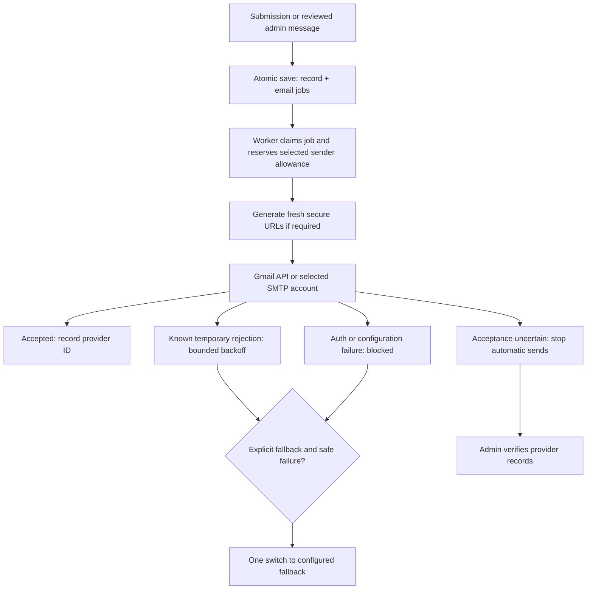

# Production email management — implementation and operations

Updated: 28 October 2026. This guide describes the implementation in this checkout. Deployment and real SMTP delivery are separate verification steps; configuring an account does not prove inbox delivery.

## What changed

The existing Email Center now contains SMTP Configuration, Manual Email Center and Delivery Activity, with navigation to the existing Form Email Routing and Template Management screens. Existing Gmail, form templates, workshop/interview/result/reminder notifications, candidate access and Sheets jobs remain on the same queue.

- Add/edit/enable/disable up to 50 SMTP accounts; explicitly choose a default. Adding an account leaves the current sender selected.
- Each account supports host/port, STARTTLS or implicit TLS, username, encrypted password, From, Reply-To, connection timeout, optional lower daily cap and connection-test history.
- Each form has independent applicant/staff sender and optional explicit fallback settings, alongside its existing template/toggle/invitation controls.
- Manual sending supports one or many candidate records, direct recipients, intake/form/status/workshop filters, saved starting templates, custom text, personalized preview, explicit test inbox, unique recipient count and bulk confirmation. A batch contains at most 500 unique addresses; messages are separate.
- Activity filters include UTC creation-date range, form/intake, candidate/reference search, purpose, sending account, status, manual/automatic, provider message ID and batch reference. Account health shows recent safe errors.
- Uncertain messages can be retried only after checking provider records, or marked accepted after an admin supplies the matching provider ID. Both actions are audited. Recording acceptance does not resend or claim confirmed inbox delivery.

## Admin setup

1. Open `/admin/email` → SMTP Configuration → Add SMTP account.
2. Enter credentials in the password field; do not put passwords in templates or messages. Blank password while editing retains the saved credential.
3. Typical Gmail settings: `smtp.gmail.com`, 587, STARTTLS, full Gmail username and a Google App Password. Use a sender allowed by the provider. Provider authentication policy still applies.
4. Save, then Verify connection. This authenticates to the SMTP server without sending a message. A successful verification does not prove that the provider will accept the configured From address.
5. To test an actual send, explicitly enter your own test inbox and queue one test email. Inspect Delivery Activity. This consumes allowance. Automated tests never send real candidate mail.
6. Choose Set default only when ready. Existing queued jobs keep their pinned sender. You must choose another default before disabling it.
7. In Form Email Routing, choose applicant and staff accounts independently. Empty primary means the default at enqueue time. Empty fallback means no fallback.
8. Review each form's own wording or shared template in Template Management. Saving wording affects newly queued messages; existing snapshots remain unchanged.

## Persistence and transactions

Production schema was inspected before implementation. Active admissions persistence is the server-only `public.platform_state` JSONB snapshot with versioned compare-and-swap through the repository. The old normalized `email_accounts` / `email_jobs` tables are retained, but do not drive this queue.

This release extends the existing `emailAccounts` metadata array inside that protected snapshot. New optional fields include authenticated ciphertext, encryption mode, Reply-To, timeout, cap, timestamps and last test. It adds `integrations.default_email_account_id`, per-form sender/fallback IDs and outbox attempt metadata. Existing objects without these properties retain Gmail / legacy SMTP behavior. Legacy metadata without credentials is shown as incomplete and cannot be chosen for new routing.

**No SQL migration or production data rewrite is required.** No tables, policies, queued messages or admissions records were dropped or reset. Account IDs are server-validated against active configured accounts; accounts are disabled, not deleted, so historical references remain available. The existing snapshot CAS provides atomic submission + jobs and concurrent claim reservations. SMTP I/O occurs outside database transactions.

The existing table has RLS enabled and the server service-role path owns access. Browser clients use authenticated, role-checked admin APIs, never a direct account/password table. This release adds no permissive policies. Preserve the existing server-only database permissions in new environments.

## Credentials and network security

- Existing `encrypt` / `decrypt` uses AES-256-GCM with a 12-byte nonce and authentication tag. Passwords are ciphertext at rest. Admin responses use an explicit projection and a `passwordSaved` flag; even ciphertext is omitted. Audit entries do not contain credentials or email bodies.
- Reuse the deployment's existing `APP_DATA_KEY` (64 hexadecimal characters). If absent, the existing `APP_SECRET` supplies the key. Do not replace either encryption key on a live deployment without a credential migration; existing Google and SMTP credentials would become unreadable.
- No new environment variable is required for UI-configured accounts. Preserve existing Supabase server configuration, `APP_SECRET`, admin login configuration, Google variables, canonical `NEXT_PUBLIC_APP_URL=https://uticx.com` and protected `CRON_SECRET`.
- Legacy `SMTP_HOST`, `SMTP_PORT`, `SMTP_SECURE`, `SMTP_USER`, `SMTP_PASS`, `SMTP_FROM_NAME`, `SMTP_FROM_EMAIL` still work as the legacy SMTP account when already configured.
- SMTP hosts are validated, resolved before configuration saves and again before every connection. Every DNS answer must be public; mixed public/private answers, loopback, private/link-local, reserved, IPv4-mapped IPv6, transition/documentation ranges and metadata targets are rejected.
- The transport connects to the validated IP and uses the original hostname for TLS certificate validation, preventing a second DNS lookup from redirecting the connection. TLS 1.2+ and certificate validation are mandatory. STARTTLS must succeed; plaintext fallback is disabled.
- Protocol debug logging, file reads and URL content loading are disabled. Admin-authored HTML goes through a restrictive sanitizer; candidate variables are escaped. Manual messages are plain text converted to safe HTML.

## Queue and fallback rules



- Jobs snapshot sender ID, optional fallback ID, content, form/candidate reference and template/version. Form custom templates use the form's saved `updated_at` as their version.
- Automatic and manual messages share durable claims, stable Message-ID, global dispatch pacing, an eight-attempt automatic retry bound, exponential backoff and rolling 24-hour reservations.
- The configured portal daily cap (1–500) applies per normalized sending identity. An account-level cap can lower it. Gmail and Googlemail aliases share the same identity and history; switching accounts does not erase recorded usage. Rejected sends release their reservation; accepted and uncertain sends retain it.
- A provider quota error pauses that identity for at least 24 hours. Waiting for allowance does not trigger fallback. Another independent configured identity and Sheets jobs can continue.
- Explicit fallback may switch once after a known temporary or configuration failure. Permanent recipient errors and uncertain sends never auto-switch. A fallback does not reset the attempt counter or bypass its own allowance.
- An expired in-flight email lease becomes Uncertain, including when SMTP accepted but the worker crashed before recording success. No universal exactly-once SMTP guarantee is claimed.
- Staff acceptance does not mark the applicant receipt sent. Sheets completion remains independent of all applicant/staff toggles and email account failures.
- Sent means provider acceptance. No delivered/opened/read state is asserted without a verified provider event. This implementation does not add provider delivery webhooks.

## Templates and manual use

The existing 17 template IDs and per-form templates remain intact. Central editing validates variables, saves versions and records the admin. Per-form custom HTML is safely rendered; central form-template editing keeps its existing plain-text conversion behavior.

Manual sending offers the saved Personal candidate message and registration/application/general confirmation starting texts, with editable subject/body. Event-specific workshop, interview, result and secure-link templates retain their existing event-driven workflows and editors. Manual text does not create a workflow transition or automatically mint an invitation just because a starting template was selected.

Manual variables: `name`, `email`, `reference`, `reference_no`, `intake`, `institution`, `formTitle`, `district`, `phone`. Direct-only recipients have no candidate reference, intake, phone or district; messages requiring missing values are rejected before enqueueing. Recipient addresses are normalized and deduplicated across candidate and direct selections. If the same address represents multiple selected records, the first selected record supplies personalization; review this before sending.

Secure candidate URLs are minted by the existing dispatch mechanism, valid for 30 minutes after dispatch; verified sessions last one hour. Do not paste expiring tokens into saved templates. Public Open application links remain directly accessible. Private tracking, documents and restricted applications retain access checks.

## Validation and release steps

Run:

```powershell
& 'C:/Program Files/nodejs/npm.cmd' run typecheck
node scripts/test.mjs
& 'C:/Program Files/nodejs/npm.cmd' run build
```

The repository has no lint script. Type checking, automated tests and production compilation are the available checks; no lint pass is claimed.

Mock SMTP tests cover public-address validation and pinned transport options, STARTTLS/TLS, Reply-To, single-recipient envelopes, auth/TLS errors, pre-DATA timeouts versus uncertain DATA outcomes, secret masking and HTML sanitation. Integration tests cover account management/defaults, routing/toggles, atomic jobs, explicit fallback, independent account failures, allowance recovery, concurrent workers, manual preview/bulk/deduplication/contact validation, admin authorization, test idempotency, delivery filters, verification and audit. Existing secure-link expiry, submissions, reminders, workshop/interview/result, Sheets and transaction regression tests run as part of the full suite. DOM tests exercise the SMTP editor and bulk confirmation flow.

For deployment, publish reviewed source with `package.json` and `package-lock.json`, allow the existing Vercel Git integration to build, then verify the ready deployment and canonical domain. Do not deploy a prebuilt test artifact made with mock environment variables. Preserve existing production secrets and scheduler configuration; no database migration command is needed.

After deployment, sign in, check Gmail remains default, review both existing form routes, confirm all prior jobs still exist, check unauthorized requests fail and verify scheduler health without enqueueing candidate messages. Then configure a real SMTP account through the admin UI and explicitly test your own inbox before selecting it as a default or override.

## Remaining operational limits

Real SMTP connection and recipient acceptance require working provider credentials, provider-approved From addresses and reachable outbound SMTP ports on the host. Mock tests do not establish that a particular provider will accept production mail. SPF, DKIM, DMARC and sender reputation remain provider/domain setup responsibilities. No Gmail Sent-read permission or delivery webhook was added. Browser visual QA, actual SMTP delivery and production deployment must be reported separately from local verification.

## Verified release record — 28 October 2026

| Check | Observed result |
| --- | --- |
| TypeScript | `npm run typecheck` passed |
| Full automated suite | 511 tests across 49 files passed, including 75 added tests |
| Production source build | Passed with an isolated mock database configuration |
| Deployment trace inspection | 94 traces; zero private files included |
| Local production HTTP checks | Passed: unauthorized access, staff login/session, masked accounts, preview/deduplication, bulk confirmation, durable queue, idempotent replay, account metadata, batch progress, session gate and production bundles |
| Live database mutation | None for this release |
| SQL migrations | None required or applied |
| Real SMTP / candidate email test | Not performed; transports mocked; local HTTP messages remained queued without a worker |
| Browser visual QA | Not verified; browser access is disabled in Work settings; DOM interaction tests passed |
| Production deployment | Not performed for this release |
| Lint | No lint script in this repository |

The local HTTP proof is stored in the ignored `.data/email-management/http-proof.json`. Test runtime data is isolated from admissions production storage. An initial static-HTML assertion was corrected after inspecting the existing client-side staff-session gate; authenticated session and client bundle checks then passed. This is not a claim of visual browser verification.

## Main changed files

| Area | Sources |
| --- | --- |
| SMTP account metadata, validation and safe projections | `src/lib/data/store.ts`, `src/lib/data/types.ts`, `src/lib/email/accounts.ts` |
| Account configuration and queued test APIs | `src/app/api/admin/email/accounts/route.ts`, `src/app/api/admin/email/accounts/test/route.ts` |
| Network and transport protection | `src/lib/email/smtp-network.ts`, `src/lib/email/smtp-client.ts`, `src/lib/email/sanitize.ts`, `src/lib/errors/provider-error.ts` |
| Form routing and automatic jobs | `src/app/api/admin/email/routing/route.ts`, `src/components/form-email-routing.tsx`, `src/lib/admissions/service.ts`, `src/lib/validations/forms.ts`, `src/app/api/admin/forms/[id]/route.ts` |
| Manual composition, preview, filters and batches | `src/components/candidate-email-composer.tsx`, `src/lib/email/manual.ts`, `src/lib/email/candidates.ts`, `src/app/api/admin/email/manual/route.ts`, `src/app/api/admin/email/manual/preview/route.ts`, `src/app/api/admin/email/candidates/route.ts` |
| SMTP settings UI and Email Center navigation | `src/components/smtp-configuration.tsx`, `src/app/admin/email/page.tsx`, `src/app/admin/email/templates/page.tsx` |
| Queue, budget, delivery and audit | `src/lib/jobs/outbox.ts`, `src/lib/email/sending-budget.ts`, `src/app/api/admin/notifications/route.ts`, `src/components/email-delivery-activity.tsx` |
| Compatibility and health checks | `src/app/api/admin/email/route.ts`, `src/app/api/admin/integrations/route.ts`, `src/app/api/cron/process-queue/route.ts`, `src/lib/email/template-catalog.ts` |
| Dependencies | `package.json`, `package-lock.json`: pinned `sanitize-html@2.18.1` and `@types/sanitize-html@2.16.2` |
| Added automated tests | `tests/integration/smtp-management.test.ts`, `tests/integration/manual-email.test.ts`, `tests/unit/smtp-transport.test.ts`, `tests/unit/email-management-ui.test.ts` |
| Guides | `docs/SMTP_EMAIL_MANAGEMENT.md`, `docs/EMAIL_PROCESS_GUIDE_TA.md`, `docs/EMAIL_TEMPLATES.md`, `docs/FORM_EMAIL_ROUTING.md` |
