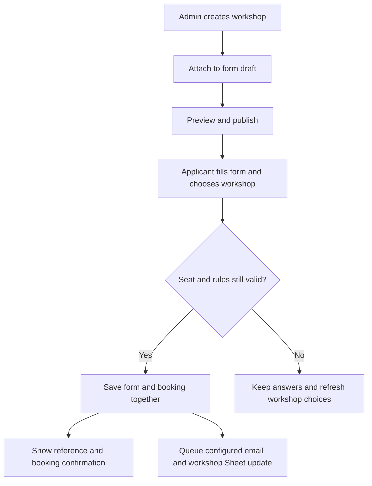

# Workshop + Form Builder — எளிமையான Implementation Plan

**திட்ட தேதி:** 28 October 2026 · **Implementation update:** 30 October 2026
**நிலை:** கீழே உள்ள core வசதிகள் implement செய்யப்பட்டு automated verification முடிந்துள்ளது. Production release நிலையை GitHub / Vercel deployment-ல் உறுதி செய்யவும். Browser visual / keyboard verification மற்றும் deployed load validation நிலுவையில் உள்ளன.
**ஆதாரம்:** தற்போதைய project code, booking rules, form builder, reminders மற்றும் Google Sheets integration ஆய்வு.

பயன்படுத்தும் படிகள்: [Workshop management தமிழ் guide](WORKSHOP_MANAGEMENT_GUIDE_TA.md). கீழே உள்ள “தற்போதைய நடத்தை” அட்டவணை implementation-க்கு முன் எடுத்த baseline; phase checkboxes implementation நிலையை காட்டுகின்றன.

## 1. நாம் உருவாக்க வேண்டிய அனுபவம்

Admin செய்ய வேண்டியது: **Workshop உருவாக்குங்கள் → Form-ன் built-in Workshop block-ல் attach செய்யுங்கள் → Preview பார்த்து Publish செய்யுங்கள்.**

அதன்பிறகு அந்த form-ஐ திறக்கும் applicant-க்கு நீங்கள் தேர்வு செய்த workshops மட்டும் தெரிய வேண்டும். Seat count, availability, bookings, attendance, emails மற்றும் Google Sheet sync ஆகியவை ஒரே workshop record-உடன் இணைந்திருக்க வேண்டும்.

முதலில் இருக்கும் வசதிகளை மேம்படுத்த வேண்டும். இன்னொரு தனி workshop system அல்லது சிக்கலான workflow designer உருவாக்க வேண்டாம்.

**இந்த plan-ல் “seat numbers” என்பது மொத்த seat capacity — உதாரணம்: 50 → 100.** ஒவ்வொரு participant-க்கும் A01 / A02 போன்ற தனி seat number ஒதுக்குவது தனியான வசதி; முதல் version-க்கு அது தேவை என்று எடுத்துக்கொள்ளவில்லை.

## 2. தற்போது இருப்பது / மாற்ற வேண்டியது

| பகுதி | தற்போதைய நடத்தை | செய்ய வேண்டிய மாற்றம் |
| --- | --- | --- |
| Workshop creation | Title, date, venue, capacity வைத்து உருவாக்கலாம் | அதே workshop-ஐ பின்னர் edit செய்ய வேண்டும் |
| Seat capacity | Create செய்யும்போது மட்டும் set செய்யலாம் | Bookings வந்த பிறகும் பாதுகாப்பாக increase / decrease செய்ய வேண்டும் |
| Form attachment | Builder → Workshop settings-ல் workshops தேர்வு செய்யலாம் | Built-in block-ல் attach / hide / preview செய்வது தெளிவாக இருக்க வேண்டும் |
| எதையும் select செய்யாத நிலை | எல்லா available workshops-ம் காட்டப்படும் | புதிய explicit-selection mode-ல் எதுவும் attach செய்யவில்லை என்றால் எதுவும் காட்டக்கூடாது |
| Show / hide | Form முழுவதற்கும் include switch உள்ளது | முழு block-ஐ hide செய்வதும், குறிப்பிட்ட workshop-ஐ அந்த form-ல் மட்டும் hide செய்வதும் வேண்டும் |
| Close bookings | `is_active` மூலம் close / reopen செய்யலாம் | Close bookings மற்றும் reminders ஆகியவற்றை பிரிக்க வேண்டும்; இப்போது scheduler-மும் அதே flag-ஐ பார்க்கிறது |
| Participants | Confirmed bookings-ஐ card-க்குள் பார்க்கலாம் | Search, status filters, source form, history, cancel / move வசதிகள் வேண்டும் |
| Google Sheets | ஒவ்வொரு workshop-க்கும் தனி tab connection ஏற்கனவே உள்ளது | இதையே பயன்படுத்தி edits / cancellations / transfers-ஐ sync செய்ய வேண்டும் |
| Public workshop display | Custom forms மற்றும் பழைய register/apply pages வேறு components பயன்படுத்துகின்றன | எல்லா booking paths-க்கும் ஒரே availability / form-attachment rules பயன்படுத்த வேண்டும் |
| Reminders | Planner தற்போது 3 நாள் / 1 நாள் defaults அனுப்புகிறது | Admin-க்கு எளிய On / Off மற்றும் reminder-day choices கொடுக்க வேண்டும் |

**முக்கியம்:** புதிய workshop உருவாக்கினாலே எல்லா forms-லும் தானாகச் சேரக்கூடாது. அந்த form-ல் attach செய்து publish செய்த பிறகுதான் வர வேண்டும்.

## 3. Admin-க்கு எளிய screens

### A. Workshops page

முதலில் workshop cards / list மட்டும். ஒவ்வொரு workshop-க்கும்:

- Title, date, time, venue, intake.
- **Total seats / Booked / Available / Attended** என்ற தெளிவான counts.
- `Edit workshop`, `View participants`, `Attach to form` actions.
- `Accept new bookings` On / Off.
- `Attached forms: 2` — எந்த forms-ல் இருக்கிறது என்று பார்க்கலாம்.
- Google Sheet connection, email settings, reminders ஆகியவை `More settings`-க்குள்; முதலில் எல்லாவற்றையும் ஒரே card-ல் விரித்துக் காட்ட வேண்டாம்.

`Edit workshop`-ல் name, date, time, venue, address, booking deadline, seat capacity மாற்றலாம். Bookings உள்ள workshop-க்கு “Duplicate as new workshop” மூலம் வேறு session உருவாக்கலாம்; பழைய participants புதிய workshop-க்கு தானாக copy ஆகக்கூடாது. Bookings உள்ள workshop-ன் intake-ஐ மாற்றக்கூடாது; முடிந்த workshop-ன் dates-ஐ மாற்றி அதையே புதிய event-ஆக பயன்படுத்தக்கூடாது.

### A1. 10 workshops இருந்தாலும் ஒவ்வொன்றுக்கும் தனி details

**உறுதி செய்யப்பட்ட தேவை:** Workshop 1 முதல் Workshop 10 வரை தனித்தனியாகத் திறந்து counts, யார் book செய்தார்கள், அவர்களுடைய phone numbers / email, attendance மற்றும் reminder delivery பார்க்க வேண்டும்.

Workshops overview-ல் ஒவ்வொன்றுக்கும் ஒரு row / card. Counts உதாரணம் மட்டும்:

| Workshop | Total seats | Confirmed bookings | Available | Details |
| --- | --- | --- | --- | --- |
| Workshop 1 | 50 | 35 | 15 | Open Workshop 1 |
| Workshop 2 | 40 | 20 | 20 | Open Workshop 2 |
| … Workshop 10 | … | … | … | அந்த workshop மட்டும் திறக்கும் |

Workshop-ஐ திறந்ததும் ஒரே detail screen-ல் எளிய tabs:

| Tab | அதில் பார்ப்பது / செய்வது |
| --- | --- |
| Overview | அந்த workshop date, venue, total seats, confirmed / cancelled counts, available seats, attended count |
| Participants | அந்த workshop-க்கு book செய்தவர்கள் மட்டும்; name, phone, email, references, source form; search / CSV |
| Attendance | அந்த workshop participants-ன் attendance மற்றும் history |
| Reminders & emails | அந்த workshop-க்கான automatic reminders, manual send preview, recipient list, delivery history |
| Google Sheet | அந்த workshop-ன் தனி tab connection மற்றும் sync status |

“All workshops” என்பது overview-க்கு மட்டும். Detail screen-ன் ஒவ்வொரு tab, count, export மற்றும் action-க்கும் selected workshop ID scope இருக்க வேண்டும். Workshop 1-ல் settings மாற்றினால் Workshop 2–10 settings மாறக்கூடாது.

### B. Form Builder-ல் built-in Workshop block

`Add built-in block → Workshop selection` என்ற entry கொடுக்க வேண்டும். இதே existing `workshop_config`-ஐ பயன்படுத்தும்; workshop பெயர்களை manual dropdown options-ஆக மறுபடியும் எழுத வேண்டாம்.

```text
Workshop selection

Show workshop selection on this form       [ ON ]
Applicant must select a workshop           [ OFF ]

Attached workshops:
  Introduction Workshop    30 Oct   20 / 50 booked   [ Show ]
  Career Workshop          02 Nov   10 / 40 booked   [ Hide ]

[ Attach workshop ]  [ Create workshop ]

Display text: Select your workshop
Show remaining seats                       [ ON ]

[ Preview ]  [ Publish changes ]
```

Rules:

1. ஒரு form-ல் ஒரு Workshop selection block மட்டும்.
2. Same intake workshops மட்டும் attach செய்யலாம்.
3. Builder-லிருந்தே சிறிய create panel திறந்து workshop உருவாக்கலாம்; உருவாக்கிய workshop தற்போதைய draft-ல் selected ஆக வேண்டும்.
4. Workshops page-ல் உருவாக்கினால் `Attach to form` மூலம் form தேர்வு செய்யலாம்; மாற்றம் அந்த form-ன் draft-ல் சேர வேண்டும்.
5. இரு entry points-மும் ஒரே draft / publish process பயன்படுத்த வேண்டும். வேறொரு unpublished draft இருந்தால் அதை silently overwrite செய்யக்கூடாது.
6. Save draft செய்தால் live form மாறக்கூடாது. Preview → Publish செய்தால் மட்டுமே applicant-க்கு மாற்றம் தெரிய வேண்டும்.
7. Preview மற்றும் live form ஒரே workshop component / rules பயன்படுத்த வேண்டும்.
8. முதல் version-ல் block தற்போதையபடி questions-க்கு கீழே இருக்கலாம். தனி drag-and-drop workflow canvas தேவையில்லை.

Workshop create வெற்றி பெற்று form draft save தோல்வியடைந்தால், `Workshop created; attachment not saved yet` என்று காட்ட வேண்டும். Retry செய்யும்போது workshop-ஐ மறுபடியும் உருவாக்காமல் அதே ID-ஐ attach செய்ய வேண்டும். Attached forms summary-ல் published attachments மற்றும் draft changes வேறுபடுத்திக் காட்டப்பட வேண்டும்.

### C. Participants page / panel

`View participants` திறந்ததும் அந்த workshop-ன் records மட்டும்:

| Column | பொருள் |
| --- | --- |
| Booking reference | மாறாத booking ID / readable reference |
| Name, email, mobile | Canonical student record-லிருந்து வரும் current contact details |
| Registration / application reference | தொடர்புடைய admissions records |
| Source form | எந்த form மூலம் book செய்தார் |
| Booked at | Booking உருவான நேரம் |
| Booking status | Confirmed / Cancelled |
| Attendance | Unmarked / Attended / Late / Absent / Excused |
| Email / Sheet status | Pending / Sent or Synced / Needs attention |

Search, booking-status filter, CSV export, `View history`, `Cancel booking`, `Move to workshop` ஆகியவை வேண்டும். Cancelled records-ஐ filter மூலம் பார்க்க முடியும்; confirmed count-க்குள் சேர்க்கக்கூடாது.

## 4. Enable / Disable / Hide — ஒவ்வொன்றுக்கும் தெளிவான அர்த்தம்

| Control | Applicant-க்கு என்ன நடக்கும்? | Existing bookings |
| --- | --- | --- |
| Form Workshop block Off | அந்த form-ல் workshop section வராது; workshop selection required ஆகாது | பாதுகாக்கப்படும் |
| குறிப்பிட்ட workshop-க்கு Hide | அந்த form-ல் மட்டும் தெரியாது; வேறு forms பாதிக்கப்படாது | பாதுகாக்கப்படும் |
| Detach from form | Form-ன் attachment list-லிருந்து நீங்கும் | Source history உட்பட பாதுகாக்கப்படும் |
| Accept new bookings Off | எந்த form மூலமும் அந்த workshop-க்கு புதிய booking செய்ய முடியாது | பாதுகாக்கப்படும்; இது event cancellation அல்ல |
| Seats full | Workshop `Full` என்று தெரியலாம்; தேர்வு செய்ய முடியாது | பாதுகாக்கப்படும் |
| Deadline / start time முடிந்தது | புதிய booking நிற்கும்; existing participants தங்கள் booking-ஐ பார்க்கலாம் | பாதுகாக்கப்படும் |
| Reminder emails Off | புதிய scheduled workshop reminders நிற்கும் | Booking / attendance பாதிக்கப்படாது |

Default display: attach செய்த full / closed future workshop-ஐ disabled நிலையில் `Full` / `Booking closed` என்று காட்டலாம். Admin குறிப்பாக Hide செய்தால் அந்த form-ல் முழுவதும் மறைய வேண்டும்.

Closed workshop-ஐ display செய்ய API metadata கொடுத்தாலும் **bookable** என்று கருதக்கூடாது. Display visibility மற்றும் booking permission ஆகியவை backend-ல் தனியாக தீர்மானிக்கப்பட வேண்டும்.

## 5. Applicant flow



- Student sees title, date, Sri Lanka time, venue, available seats; long technical settings தெரியக்கூடாது.
- ஒரு form response-க்கு ஒரு workshop choice. Existing duplicate protection தொடர வேண்டும்.
- Required Off என்றால் workshop தேர்வு செய்யாமல் submit செய்யலாம்.
- Required On, ஆனால் bookable workshops இல்லை என்றால் தெளிவான message வேண்டும்; silent bypass அல்லது முடிவில்லாத dropdown இருக்கக்கூடாது.
- Required block-க்கு bookable workshop இல்லாமல் publish செய்யும்போது admin-க்கு warning / validation வேண்டும். Live-ல் பின்னர் seats நிரம்பினால் applicant answers பாதுகாக்கப்பட்டு contact / refresh options தெரிய வேண்டும்.
- Seat உறுதி ஆகுவது **form + booking database save வெற்றி அடைந்த பிறகு**. Application approval கிடைத்த பிறகுதான் booking என்று தவறாக message காட்டக்கூடாது.
- Seat full / hidden / closed ஆகிய மாற்றங்களால் submit தோல்வியடைந்தால், மற்ற answers மற்றும் uploads-ஐ அழிக்காமல் புதிய choices load செய்ய வேண்டும்.
- Page open இருக்கும்போது choices-ஐ bounded refresh செய்ய வேண்டும்; focus திரும்பும்போதும் refresh செய்யலாம். Final availability check எப்போதும் server-ல் நடக்க வேண்டும்.

## 6. Seat count மாற்றுவதற்கான rules

Example: capacity 50, confirmed bookings 35.

| மாற்றம் | முடிவு |
| --- | --- |
| 50 → 80 | அனுமதி; available seats 45 |
| 50 → 35 | அனுமதி; available seats 0; Full |
| 50 → 30 | நிராகரிக்க வேண்டும்; ஏற்கனவே 35 confirmed bookings உள்ளன |
| Cancelled booking | Confirmed count-லிருந்து நீக்கப்படும்; workshop open என்றால் seat மீண்டும் கிடைக்கும் |
| Same applicant retries same booking | புதிய seat consume ஆகக்கூடாது |

Capacity-ஐ நேரடியாக booking count field-ஆக பயன்படுத்த வேண்டாம். **Available = capacity − confirmed bookings** என்று current records-லிருந்து கணக்கிட வேண்டும்.

Capacity edit மற்றும் புதிய booking ஒரே நேரத்தில் வந்தாலும் ஒரே transaction / version check மூலம் rules நிறைவேற வேண்டும். Form-ல் காட்டிய பழைய available count-ஐ நம்பி booking commit செய்யக்கூடாது.

Admin error உதாரணம்: `35 participants are already booked. Set at least 35 seats, or move/cancel bookings first.`

## 7. Records ஒழுங்காக maintain ஆக வேண்டிய விதம்

1. Student, registration, application, form response, workshop, booking ஆகியவற்றுக்கு தனித்தனி stable IDs தொடர வேண்டும்.
2. Workshop name / date / capacity edit செய்தால் புதிய workshop ID உருவாக்கக்கூடாது.
3. Form response-க்கு அப்போது தேர்வு செய்த workshop ID மற்றும் display snapshot இருக்க வேண்டும். Historical snapshot மற்றும் current workshop details தனியாக காட்டப்பட வேண்டும்.
4. Booking-க்கு source submission IDs இணைக்க வேண்டும். ஒரே workshop booking வேறு form-லிருந்து மீண்டும் பயன்படுத்தப்பட்டால் புதிய source link சேரலாம்; புதிய booking / seat உருவாகக்கூடாது.
5. அதே student + workshop-க்கு இரண்டு confirmed bookings இருக்கக்கூடாது. Repeated submit, double click, network retry, webhook retry அனைத்தும் ஒரே accepted result-ஐ மீண்டும் தர வேண்டும்.
6. வேறு workshops-க்கு booking செய்வது பற்றிய தற்போதைய policy-ஐ திடீரென மாற்ற வேண்டாம். “ஒரு intake-க்கு ஒரே workshop” போன்ற புதிய restriction தேவையானால் தனி advanced rule-ஆக பின்னர் சேர்க்கலாம்.
7. Cancel செய்யும்போது record delete செய்யாமல் status, காரணம், யார் செய்தார், நேரம் சேமிக்க வேண்டும். Seat release, audit, sync job ஆகியவை ஒரே commit-ல் நடக்க வேண்டும்.
8. Move செய்யும்போது target workshop intake / availability / seats மீண்டும் check செய்ய வேண்டும். Old booking-ஐ cancelled / moved history-உடன் வைத்துவிட்டு linked new booking உருவாக்க வேண்டும்; பழைய workshop ID-ஐ overwrite செய்யக்கூடாது.
9. Transfer முழுவதும் வெற்றி பெற வேண்டும் அல்லது எந்த மாற்றமும் இல்லாமல் தோல்வியடைய வேண்டும். Old seat release செய்து new seat கிடைக்காத பாதி நிலையில் இருக்கக்கூடாது.
10. Attendance / exam records உள்ள participant-ஐ silently move செய்யக்கூடாது. Existing downstream links-க்கு ஏற்ப block அல்லது தனி reviewed correction flow வேண்டும்.
11. Contact details edit செய்யும்போது existing Candidate Email Correction வசதியை பயன்படுத்த வேண்டும்; booking-க்காக duplicate student உருவாக்கக்கூடாது.
12. Workshop edit, capacity change, attach / hide / detach, cancel / move, reminder changes அனைத்துக்கும் actor, timestamp, before / after values உடன் audit trail வேண்டும்.

**Counts தெளிவாக:** 100 form responses, 80 unique students, 60 confirmed bookings ஆகியவை வெவ்வேறு அளவுகள். ஒன்றை மற்றொன்றாக dashboard-ல் காட்டக்கூடாது.

## 8. Workflow-ஐ எளிதாக மாற்றும் முறை

Form settings-ல் எளிய ready-made flows காட்டலாம்; அவை existing form access மற்றும் workshop settings-ஐ அமைக்கும் shortcuts ஆக இருக்க வேண்டும்.

| Flow | பயன்படுத்தும் சூழல் |
| --- | --- |
| Open form → Workshop choice → Submit | முன் registration form நிரப்பாமல் workshop-உடன் submit செய்யலாம் |
| Open application → Workshop choice → Submit | Application நேரடியாக open; invitation / secure email link முன்கூட்டியே கட்டாயமில்லை |
| Registered applicants → Application → Workshop choice | முன் registration தேவைப்படும் admissions flow |

Required / optional workshop choice-ஐ ஒவ்வொரு flow-லும் மாற்றலாம். Flow மாற்றம் புதிய submissions-க்கு மட்டும் பொருந்த வேண்டும்; பழைய applications / bookings-ஐ மறுபடியும் உருவாக்கவோ மாற்றவோ கூடாது.

Internal tracking-க்கு registration link உருவாவதும், applicant ஒரு தனி registration form நிரப்ப வேண்டுமென்பதும் வேறு. Open flow-ல் தேவையில்லாத extra screen காட்ட வேண்டாம். Private tracking / documents access-க்கு இருக்கும் secure-link protection தொடர வேண்டும்.

Preset மாற்றுவதற்கு முன் `Who can submit?`, `Workshop required?`, `Which workshops?`, `Which emails?` என்ற சுருக்கம் காட்ட வேண்டும். Template text, form questions, closing date போன்ற unrelated settings overwrite ஆகக்கூடாது.

## 9. Emails, reminders, Google Sheets

### Emails

- Existing Email Center / templates-ஐ பயன்படுத்த வேண்டும்; இன்னொரு template editor உருவாக்க வேண்டாம்.
- Form receipt மற்றும் workshop booking confirmation எந்தெந்த emails என்று admin-க்கு பெயருடன் காட்ட வேண்டும். இரண்டும் On என்றால் இரண்டு தனி messages செல்லும் என்பது preview-ல் தெளிவாகத் தெரிய வேண்டும்.
- Existing live email choices-ஐ migration தானாக மாற்றக்கூடாது. ஒரே combined confirmation வேண்டுமெனில் explicit setting + preview மூலம் மட்டுமே மாற்ற வேண்டும்.
- Attach, hide, capacity edit அல்லது reopen செய்ததற்காக applicant confirmation மீண்டும் அனுப்பக்கூடாது.
- Date / venue change-க்கு affected participants count மற்றும் notification preview கொடுக்க வேண்டும்; admin `Send update` தேர்வு செய்தால்தான் change notification queue ஆக வேண்டும்.
- New bookings close செய்தாலும் existing confirmed participants-க்கு configured reminders தொடர வேண்டும். Reminders நிறுத்த தனி control வேண்டும்.
- Date மாற்றிய பிறகு பழைய நேரத்தைச் சொல்லும் queued reminder செல்லக்கூடாது. Worker dispatch முன் current event / booking version மீண்டும் check செய்ய வேண்டும்; superseded jobs காரணத்துடன் நிறுத்தப்பட வேண்டும்.
- ஏற்கனவே sent / provider-accepted / uncertain delivery history பாதுகாக்கப்பட வேண்டும்; uncertain job-ஐ blind retry செய்து duplicate mail அனுப்பக்கூடாது.

### ஒவ்வொரு workshop-க்கும் தனி reminder controls

Workshop detail → `Reminders & emails`-ல்:

1. **Automatic reminders On / Off** — இந்த workshop-க்கு மட்டும்.
2. **When to remind** — உதாரணம்: 3 நாட்கள் முன்பு, 1 நாள் முன்பு; அந்த workshop date / time அடிப்படையில் schedule.
3. **Template choice** — existing Email Center template-ஐ தேர்வு செய்து preview பார்க்கலாம். அதே template-ஐ பல workshops பயன்படுத்தலாம்; ஒவ்வொரு mail-லும் சரியான workshop name / date / venue வர வேண்டும். Shared template text edit செய்தால் அதைப் பயன்படுத்தும் எல்லா workshops-க்கும் பொருந்தும் என்பதை UI தெளிவாகக் காட்ட வேண்டும்.
4. **Send reminder now** — அந்த workshop-ன் eligible confirmed participants மட்டும் preview-ல் வர வேண்டும்; அனைவரையும் அல்லது சிலரை select செய்து final `Send` செய்யலாம்.
5. **Delivery history** — அந்த workshop-க்கு மட்டும் Pending / Sent / Failed / Needs attention; participant, reminder type, scheduled / sent time, error பார்க்கலாம்.

Recipient rules:

- Workshop 1 reminder → Workshop 1-ல் confirmed booking உள்ளவர்களுக்கு மட்டும். Workshop 2–10 participants தானாக recipient list-ல் சேரக்கூடாது.
- Cancelled / பழைய workshop-லிருந்து moved bookings-க்கு அந்த பழைய workshop reminder அனுப்பக்கூடாது.
- Manual preview பார்த்த பிறகு booking / contact details மாறியிருந்தால் final send முன் மீண்டும் validate செய்ய வேண்டும். Dispatch நேரத்திலும் current booking eligibility check வேண்டும்.
- ஒரே applicant இரண்டு workshops-ல் book செய்திருந்தால், அவருக்குத் தொடர்புடைய இரண்டு workshops-ன் reminders தனித்தனியாக வரலாம். Duplicate protection workshop + booking + reminder occurrence அடிப்படையில் இருக்க வேண்டும்; email address மட்டும் வைத்து மற்ற workshop reminder-ஐ தவறாக skip செய்யக்கூடாது.
- ஒரே reminder-ஐ retry / repeated click செய்ததற்காக அதே workshop participant-க்கு மீண்டும் queue செய்யக்கூடாது. ஒரு புதிய manual reminder அனுப்புவது explicit புதிய send action ஆக இருக்க வேண்டும்; recently sent warning / recipient preview தொடர வேண்டும்.
- `35 booked participants` மற்றும் `70 reminder deliveries` வெவ்வேறு counts; 3-day + 1-day mails அனுப்பியதால் participant count அதிகரித்ததாகக் காட்டக்கூடாது.

**எளிய உதாரணம்:** Workshop 1-ல் 35 பேர், Workshop 2-ல் 20 பேர். Workshop 1 → `Send reminder now` திறந்தால் அதிகபட்சம் அந்த 35 eligible participants மட்டும் preview-ல் வர வேண்டும். Workshop 2-ன் 20 பேரும் அதில் கலக்கக்கூடாது.

### Google Sheets

- ஒவ்வொரு workshop-க்கும் ஏற்கனவே உள்ள தனி spreadsheet / tab connection தொடர வேண்டும்.
- Booking ID அடிப்படையிலான upsert தொடர வேண்டும்; workshop பெயர் மாறினாலும் duplicate rows உருவாகக்கூடாது.
- Cancel செய்தால் பழைய row-ல் Cancelled update ஆக வேண்டும். Move செய்தால் old workshop tab-ல் cancelled / moved record, new workshop tab-ல் new linked booking வர வேண்டும்.
- Workshop date / venue போன்ற exported values மாறினால் affected booking rows current destination-க்கு queue ஆக வேண்டும்.
- Hidden / detached forms காரணமாக பழைய Sheet rows அல்லது booking history delete ஆகக்கூடாது.
- Google / SMTP error வந்தாலும் saved registration, application மற்றும் booking அழியக்கூடாது. Queue status மற்றும் repair action தெளிவாகக் காட்டப்பட வேண்டும்.

## 10. Implementation design — existing code-ஐ reuse செய்வது

### ஒரே source of truth

Existing `workshops`, `workshopBookings`, `customForms.workshop_config`, `formSubmissions`, `auditLogs`, `outbox` records-ஐ பயன்படுத்த வேண்டும். Public availability, submit validation, Builder preview, legacy pages மற்றும் webhook paths அனைத்தும் ஒரே policy resolver பயன்படுத்த வேண்டும்.

Proposed additions கீழே logical fields; implementation நேரத்தில் exact names finalize செய்யலாம்:

| Record | குறைந்தபட்ச addition / மாற்றம் |
| --- | --- |
| Workshop | Edit version / updated timestamp, independent reminders switch; existing `is_active`-ஐ புதிய bookings flag ஆக தெளிவுபடுத்துதல் |
| Form workshop config | Explicit selection mode, attached IDs, hidden IDs subset, editable label / help text / empty-state message, show-seat-count preference |
| Workshop booking | Source submission IDs, cancellation metadata, transfer links, change version |
| Form submission | Selected workshop display snapshot; historical answers / labels தொடர்ந்து பாதுகாத்தல் |
| Outbox job | Relevant workshop / booking version for stale reminder checks; existing durable job IDs / reconciliation தொடருதல் |

`workshop_ids` attachment list-ஐ authoritative-ஆக வைத்தால் அதையே duplicate செய்யும் இரண்டாவது list உருவாக்க வேண்டாம். Hidden IDs attached IDs-ன் subset ஆக validate செய்ய வேண்டும். புதிய explicit mode-ல் empty attached list = **no workshops**.

Workshop create / booking cancel / transfer போன்ற retry செய்யக்கூடிய mutations-க்கு persisted idempotency key வேண்டும். Capacity / workshop edit, form publish போன்ற saves-க்கு expected version வேண்டும்; stale save-க்கு reload / review response கொடுக்க வேண்டும். Workshop create, attachment save மற்றும் booking commit ஆகியவற்றை ஒரே operation என்று தவறாக UI காட்டக்கூடாது.

தற்போதைய production persistence server-only `platform_state` JSONB + versioned repository. முதல் version-க்கு இந்த architecture-ஐ reuse செய்யலாம்; arbitrary புதிய SQL tables / migration உடனே தேவையில்லை. Global snapshot contention காரணமாக peak load-ஐ தனியாக அளவிட வேண்டும்; இந்த UI change மட்டும் 300 concurrent submissions-க்கு guarantee அல்ல.

### முக்கிய code touchpoints

| பகுதி | தற்போதைய source |
| --- | --- |
| Workshop planner / participants | `src/app/admin/workshops/page.tsx` |
| Workshop create / update API | `src/app/api/admin/workshops/route.ts` |
| Builder attachment / create action | `src/components/form-builder/form-settings.tsx`, `editor.tsx` |
| Builder preview | `src/components/form-builder/preview.tsx` |
| Form configuration validation | `src/lib/validations/forms.ts`, `src/lib/validations/workshop.ts` |
| Public form / submission | `src/app/form/[slug]/page.tsx`, `src/app/api/forms/[slug]/route.ts` |
| Availability / atomic booking | `src/lib/admissions/service.ts`; shared workshop policy helper-ஆக பிரிக்கலாம் |
| Legacy choices / public API | `src/components/workshop-choice.tsx`, `src/app/api/workshops/route.ts`, register / apply paths |
| Stable records / transactions | `src/lib/data/store.ts`, `types.ts`, `repository.ts` |
| Scheduled reminders | `src/lib/jobs/scheduled-queue.ts`, existing outbox worker |
| Workshop Google Sheets | `src/lib/workshops/`, `src/components/workshop-sheet-connection.tsx` |
| Action permissions | `src/lib/security/session.ts` மற்றும் workshop write handlers |

Admin / Super Admin மட்டும் workshop edit, capacity, form attachment, cancellation / transfer மற்றும் sending settings மாற்ற வேண்டும். Entrance staff-க்கு permitted participant lookup / attendance மட்டும். தற்போதைய path-based permission மட்டும் workshop write methods-ஐ பிரிக்காததால் server-side action checks சேர்க்க வேண்டும்; buttons hide செய்வது மட்டும் போதாது.

## 11. பழைய records-ஐ பாதுகாத்து rollout செய்வது

1. Verified backup எடுத்து workshop / booking / form / application counts மற்றும் stable IDs baseline சேமிக்க வேண்டும்.
2. Existing empty `workshop_ids` தற்போது “all available” என்ற அர்த்தம் கொண்டது. அதை ஒரே நேரத்தில் “none” என்று மாற்றி live forms-ஐ உடைக்கக்கூடாது.
3. Existing configs-க்கு legacy mode compatibility வைக்க வேண்டும். Admin முதல் முறையாக புதிய editor-ல் மாற்றும்போது தற்போது பொருந்தும் workshops-ஐ காட்டி explicit list review / publish செய்ய வேண்டும். Form future workshops-ஐ தானாகக் காட்டும் நடத்தை மாறுவதையும் தெளிவாகச் சொல்ல வேண்டும்.
4. Existing records-க்கு missing metadata மட்டும் backfill செய்ய வேண்டும். Student IDs, booking IDs, references, accepted answers, attendance மற்றும் sent email history மாறக்கூடாது.
5. Draft form configs-யும் migration-ல் கணக்கில் கொள்ள வேண்டும்; published config-ஐ draft-ஆல் overwrite செய்யக்கூடாது.
6. New defaults பழைய reminder / email delivery choices-ஐ silently மாற்றக்கூடாது; closing bookings மற்றும் reminder behavior பிரியும் மாற்றத்தை admin-க்கு காட்ட வேண்டும்.
7. Existing public URLs, Sheet destinations மற்றும் secure candidate tracking compatibility சரிபார்த்த பிறகு release செய்ய வேண்டும்.
8. Rollback செய்தாலும் புதிய fields காரணமாக records reset / drop ஆகக்கூடாது; reader compatibility மற்றும் backup recovery முன்கூட்டியே சோதிக்க வேண்டும்.

## 12. செய்ய வேண்டிய வரிசை

### Phase 1 — முதலில் தேவையான controls

- [x] Shared workshop visibility / booking rules மற்றும் backward-compatible config defaults.
- [x] Edit workshop: capacity, date, venue, deadline; stale edit protection.
- [x] Built-in Workshop block: attach existing / create new, full-block On / Off, required / optional, per-form Show / Hide.
- [x] Explicit attachment list; empty selection தானாக எல்லாவற்றையும் காட்டாதபடி மாற்றம்.
- [x] Preview / Publish மற்றும் live form-க்கு ஒரே rendering / eligibility rules.
- [x] Same-intake validation, action permissions, safe final-seat allocation (local tests passed; production contention validation pending).

**Phase 1 முடிவு:** Workshop create செய்து form-ல் attach / hide செய்யலாம்; capacity edit செய்யலாம்; new applicant சரியான workshops-ஐ மட்டும் பார்த்து submit செய்யலாம்.

### Phase 2 — Records மற்றும் daily operations

- [x] ஒவ்வொரு workshop-க்கும் தனி detail screen: overview, searchable participants / phone numbers, attendance, source form, counts, CSV, history.
- [x] Cancel / move booking with atomic seat updates and downstream attendance / exam checks.
- [x] Stable source links / historical snapshots / audit trail.
- [x] Existing workshop Sheet sync-ல் edits, cancellations, transfers update செய்தல்.

### Phase 3 — Workflow மற்றும் communication எளிமை

- [x] Existing access settings-க்கு ready-made flow shortcuts மற்றும் draft / publish notices.
- [x] ஒவ்வொரு workshop-க்கும் confirmation / reminder switches, template routing links, editable reminder-day choices, manual recipient preview மற்றும் தனி delivery history.
- [x] Date / venue changes-க்கு notification preview; outdated queued reminders dispatch ஆகாமல் guard.
- [x] Planner-ன் advanced settings collapse; responsive layout மற்றும் DOM interaction tests.
- [ ] Browser-ல் desktop / mobile / keyboard usability verification — தற்போதைய settings-ல் browser access disabled.

Waitlist, paid tickets, QR seating, physical seat allocation மற்றும் arbitrary drag-and-drop workflow engine ஆகியவை முதல் release scope-ல் சேர்க்க வேண்டாம். Core controls எளிதாக வேலை செய்த பிறகு தேவைப்பட்டால் மட்டும் சேர்க்கலாம்.

## 13. Implementation முடிந்தது என்று சொல்ல வேண்டிய acceptance checks

1. Workshop A create → Form A attach → Publish: Form A-ல் வருகிறது; attach செய்யாத Form B-ல் வரவில்லை.
2. Builder-லிருந்து create செய்யும்போது current draft answers / settings தொலையவில்லை; workshop ஒருமுறை மட்டுமே உருவாகிறது.
3. Form A-ல் workshop Hide செய்தால் Form B visibility மற்றும் existing bookings பாதிக்கப்படவில்லை.
4. Full block Off என்றால் selection கட்டாயமில்லை; பழைய saved choice / forged hidden ID மூலம் புதிய booking செய்ய முடியவில்லை.
5. Explicit selection mode-ல் empty list எந்த workshop-ஐயும் தானாக attach செய்யவில்லை.
6. Required workshop இல்லாமல் submit ஏற்கப்படவில்லை; optional mode-ல் workshop இல்லாமல் submit செய்ய முடிகிறது.
7. Capacity 50 → 80 சரி; confirmed bookings-க்குக் கீழே capacity குறைப்பது நிராகரிக்கப்படுகிறது.
8. Last seat-க்கு concurrent requests வந்தால் ஒரே confirmed booking மட்டும்; மற்ற request-க்கு safe retry / full result, partial student records இல்லை.
9. Double click / retry / webhook replay duplicate student, booking, seat அல்லது confirmation job உருவாக்கவில்லை.
10. Cancel ஒரு seat-ஐ மட்டுமே release செய்கிறது; repeated cancel அதையே மீண்டும் release செய்யவில்லை.
11. Transfer வெற்றி பெற்றால் old / new counts, history, source links, Sheet rows சரி; target full என்றால் old booking அப்படியே உள்ளது.
12. Date / venue edit செய்த பிறகு current participants screen / tracking / Sheet details சரி; பழைய reminder தப்பான நேரத்துடன் செல்லவில்லை.
13. New bookings close செய்ததற்காக reminders தானாக நிற்கவில்லை; Reminder Off தனியாக வேலை செய்கிறது.
14. Non-admin direct API calls மூலம் workshop settings அல்லது seat count மாற்ற முடியவில்லை.
15. Google / SMTP failure-ல்கூட accepted records பாதுகாப்பாக உள்ளன; provider retry-ல் duplicate delivery / rows இல்லை.
16. Existing registration / application flows, open application mode, secure tracking, documents, attendance, exam links மற்றும் old URLs regression checks pass.
17. தனிமைப்படுத்திய test data-வில் 100–300 simultaneous submit attempts: accepted count capacity-ஐ மீறவில்லை; contention / retries / latency அளவிடப்பட்டுள்ளன. Real applicants-க்கு test emails அனுப்பப்படவில்லை.
18. Desktop / mobile / keyboard flow browser-ல் பார்த்து சரிபார்க்கப்பட்டுள்ளது; unit tests மட்டும் வைத்து visual verification முடிந்ததாகக் கருதவில்லை.
19. 10 workshops கொண்ட test data-வில் ஒவ்வொரு detail screen-க்கும் சரியான participants / phone numbers / counts / exports மட்டும் வருகின்றன; Workshop 1 action Workshop 2–10 records-ஐ மாற்றவில்லை.
20. Workshop 1 reminder preview / dispatch / delivery logs-ல் அதன் eligible participants மட்டும் உள்ளனர்; cancelled / moved bookings வெளியேற்றப்படுகின்றன. ஒரே applicant-ன் வேறு workshop reminders தவறாக deduplicate ஆகவில்லை; அதே occurrence-ன் retries duplicate mail உருவாக்கவில்லை.

## 14. இந்த plan-ன் priority

**முதலில்:** workshop edit + seat count + built-in form attachment + தெளிவான Show / Hide / booking controls.
**அடுத்து:** records, participants, cancel / move, Sheet reconciliation.
**பிறகு:** எளிய workflow shortcuts மற்றும் communication controls.

ஒவ்வொரு phase-லும் existing records மற்றும் working features பாதுகாக்கப்பட்டு, admin செய்ய வேண்டிய clicks / decisions குறைய வேண்டும்.
